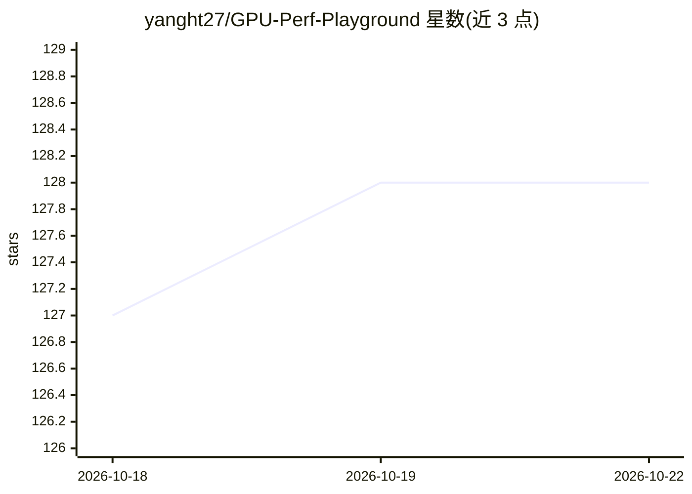

# yanght27/GPU-Perf-Playground

⭐ 128 · Python · Apache-2.0 · 推送 2026-09-08 · [GitHub](https://github.com/yanght27/GPU-Perf-Playground) · 个人维护 · 中文 README

**面向初学者的 GPU 性能与 AI Infra 学习项目（29 个增量 Ticket）**

GPU 性能与 AI Infra 的结构化学习实践仓库：以 29 个最小增量 Ticket（T00–T28）覆盖 CUDA/Triton/cuTile/CuTe DSL 五路径算子实现、NCU/NSYS/SASS 工具取证、vLLM/SGLang/TensorRT-LLM/ms-swift 推理框架实战、PyTorch/DeepSpeed/ms-swift 训练与 DP/DDP/ZeRO/FSDP/TP/PP/SP/CP 并行架构。每个 Ticket 配任务书、讲义与 scripts/ 一键复现脚本，采用实现→讲解→验收的闭环方式。作者基于 RTX 4070 Laptop/WSL2 边实现边学习，声明用于学习教学、不保证生产级性能。

## 筛选速览

| 维度 | 判定 | 备注 |
|---|---|---|
| AI 角色 | `ai-knowledge` | 知识聚合/清单类 |
| 许可风险 | `permissive` | Apache-2.0 |
| 部署形态 | `None` |  |
| 模型依赖 | — | README 未给出锁定关系 |
| 硬件要求 | — | 无带数字的原话,不猜 |
| 安装摩擦 | `medium` | 含编译或系统依赖之一 |
| 成熟度 | — | 结构信号不足 |

## 能力要点

- 29 个最小增量 Ticket 覆盖从算子到并行架构全链路
- PyTorch/CUDA C++/Triton/cuTile/CuTe DSL 五路径算子横向对比
- NCU/NSYS/SASS 工具取证与每个 Ticket 的一键复现脚本
- 讲义双写：对话讲解同步落盘到 docs/lectures/

## 适用场景

- 系统学习 CUDA 算子优化与 GPU 性能调优
- 动手实践 vLLM/SGLang/TRT-LLM 等推理框架的启动与对比
- 理解 ZeRO/FSDP/TP 等训练并行架构并复现实验

## 场景标签

 · 领域:GPU/AI 基础设施学习

## 证据(README 行号)

> L3: > 一个面向初学者的 **GPU 性能与 AI Infra 学习项目**：从 CUDA 算子、性能工具，到推理框架、训练框架和并行架构，通过 29 个最小增量 Ticket 逐步掌握。
> L24: - 📚 **29 个最小增量**：T00–T28，从零基础到 AI Infra 全链路。
> L30: - ✅ **可复现**：每个 Ticket 都有 `scripts/` 一键复现。

## 星数曲线

2026-10-18 127 → 2026-10-22 128（+1）

---
*卡片 v1 · prompt 1.4 · 生成 2026-10-22 · 置信度 high · 依据 README sha `4ab8e60a229d` · [字段定义](../../DATASET.md)*
