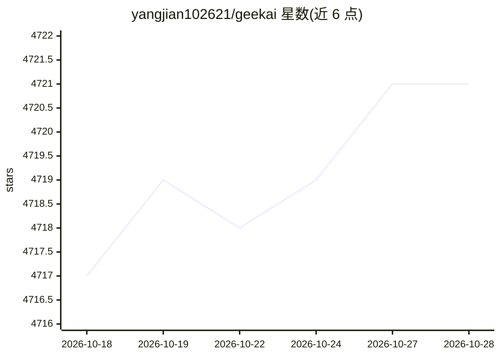

# yangjian102621/geekai

⭐ 4,721 · Vue · Apache-2.0 · 推送 2026-09-13 · [GitHub](https://github.com/yangjian102621/geekai) · [官网](https://chat.geekai.me) · 个人维护 · 中文 README

**面向创作者与企业的多模态 AI 内容创作平台，含运营后台**

Go + Vue3 + Element Plus 实现的 AI 内容创作与运营平台：集成多款大语言模型提供对话，接入 MidJourney、DALL-E 等绘画引擎，另含 Suno 音乐生成、Luma/即梦/可灵等视频生成与 AI 思维导图。配套用户系统、积分计费、管理后台与数据统计，支持七牛云/阿里云 OSS/腾讯云 OSS/Minio 存储。部署方式为 docker-compose 一键启动；私有化部署不支持自动升级，需手动升级。

## 筛选速览

| 维度 | 判定 | 备注 |
|---|---|---|
| AI 角色 | `ai-native` | 本体是模型或模型工具 |
| 许可风险 | `permissive` | Apache-2.0 |
| 部署形态 | `self-host` | docker 或自建部署 |
| 模型依赖 | locked-api |  |
| 硬件要求 | — | 无带数字的原话,不猜 |
| 安装摩擦 | `low` | 无编译、无系统依赖或容器化 |
| 成熟度 | — | 结构信号不足 |

## 能力要点

- 集成多平台大语言模型对话与角色扮演
- 绘画（MidJourney/DALL-E/Nano-Banana/即梦/可灵）、音乐（Suno）、视频（Luma/Veo3）多模态生成
- 用户系统、积分计费、订阅模式与管理后台
- docker-compose 容器化部署，支持私有化部署

## 适用场景

- 搭建自己的 AI 对话、绘画、音乐、视频创作站点
- 运营一个带计费和管理后台的 AI 创作服务
- 个人或团队内容创作（博客素材、短视频、课件）

## 场景标签

`图像生成` `视频生成` `多模态` `聊天机器人` · 领域:对话与助手

## 证据(README 行号)

> L5: 一个功能完整、开箱即用的 AI 多模态内容创作平台，集成了对话、绘画、音乐、视频、思维导图等全链路 AI 创作能力。无论是个人创作者还是企业团队，都能快速搭建属于自己的 AI 创作工作台。
> L11: - **智能对话**：集成 ChatGPT、Claude 等多款顶级 AI 模型，支持角色扮演和专业对话

## 星数曲线

2026-10-18 4,717 → 2026-10-28 4,721（+4）

---
*卡片 v1 · prompt 1.4 · 生成 2026-10-20 · 置信度 high · 依据 README sha `78303469953f` · [字段定义](../../DATASET.md)*
