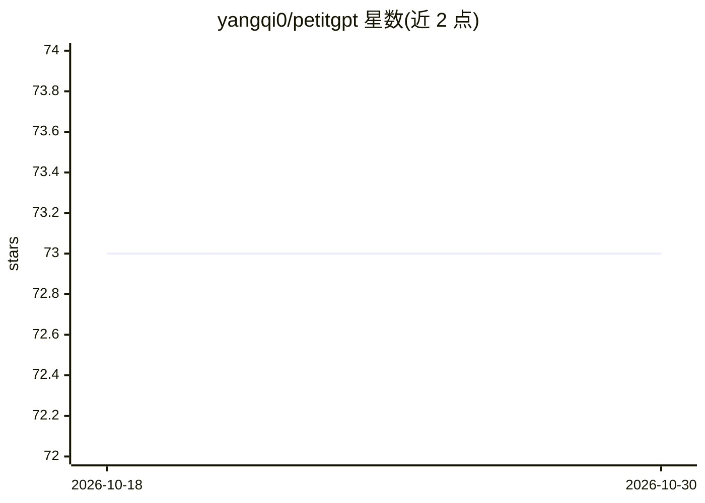

# yangqi0/petitgpt

⭐ 73 · Python · Apache-2.0 · 推送 2026-10-11 · [GitHub](https://github.com/yangqi0/petitgpt) · [官网](https://huggingface.co/yqi0/petitgpt) · 个人维护

**单卡 RTX 4090 从零训练的 124.6M 研究型 LLM 及全流程复现**

研究项目：在单张 RTX 4090 上以约 13B token 从零预训练 124.6M 参数语言模型，覆盖自定义 3.2 万词表字节级 BPE 分词器、预训练、SFT/DPO/蒸馏等后训练实验、评测（ARC/PIQA/HellaSwag/IFEval，与 SmolLM/SmolLM2 对比）及原生 PyTorch CUDA 推理 CLI。发布 checkpoint 为 alpha075（P2/P3 参数插值）。限制：发布格式为原生 PyTorch，GGUF/ONNX/vLLM/llama.cpp/CPU 未实现或验证；未面向生产或高风险场景。

## 筛选速览

| 维度 | 判定 | 备注 |
|---|---|---|
| AI 角色 | `ai-native` | 本体是模型或模型工具 |
| 许可风险 | `permissive` | Apache-2.0 |
| 部署形态 | `None` |  |
| 模型依赖 | — | README 未给出锁定关系 |
| 硬件要求 | — | 无带数字的原话,不猜 |
| 安装摩擦 | `medium` | 含编译或系统依赖之一 |
| 成熟度 | — | 结构信号不足 |

## 能力要点

- 单张 RTX 4090、约 13B token 的从零预训练全流程
- 自定义 32,000 词表字节级 BPE 分词器
- 含评测协议区分似然基准与生成式 IFEval，并与 SmolLM/SmolLM2 在固定协议下对比
- 原生 PyTorch CUDA 推理 CLI，支持 bf16_native 与 fp32_math 两种数值模式

## 适用场景

- 研究者复现小预算预训练与后训练流程
- 在小模型上做 SFT/DPO/蒸馏/LoRA 等受控实验
- 研究评测协议：区分似然分数与完整生成回答正确性

## 场景标签

`模型训练` `微调` `模型评测` · 领域:评测与运维

## 证据(README 行号)

> L3: **A 124.6M-parameter language-model research project, from tokenizer training and pretraining to post-training, eval
> L24: |Released inference|Native PyTorch on CUDA; stored FP32 weights|
> L92: **A CUDA GPU is required by the released CLI.** Use an environment compatible with the tested dependencies and run 

## 星数曲线

2026-10-18 73 → 2026-10-30 73（+0）

---
*卡片 v1 · prompt 1.4 · 生成 2026-10-24 · 置信度 high · 依据 README sha `d12984c2107d` · [字段定义](../../DATASET.md)*
