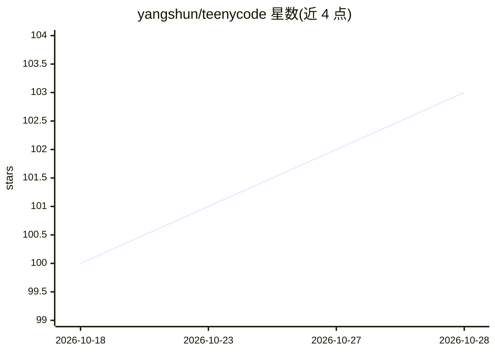

# yangshun/teenycode

⭐ 103 · TypeScript · MIT · 推送 2026-04-28 · [GitHub](https://github.com/yangshun/teenycode) · 个人维护

**给开发者的约 200 行 TypeScript 教学用编码 agent CLI**

面向教育目的的极简命令行编码 agent，用约 200 行 TypeScript 实现调用 OpenAI Chat Completions 与 function/tool calling 的聊天循环。内置 read_file、list_files、edit_file 三个基于 Node fs 的文件工具，工具入参用 Zod 校验并导出 JSON Schema。刻意不包含 bash 工具以控制风险，编辑策略为优先读取文件、做最小改动。通过 npx 免克隆运行或 npm 源码运行，需 Node.js 22+ 与 OpenAI API key。改编自 Amp 的 How to Build an Agent。

## 筛选速览

| 维度 | 判定 | 备注 |
|---|---|---|
| AI 角色 | `ai-native` | 本体是模型或模型工具 |
| 许可风险 | `permissive` | MIT |
| 部署形态 | `library` | 以包/库形式分发 |
| 模型依赖 | — | README 未给出锁定关系 |
| 硬件要求 | — | 无带数字的原话,不猜 |
| 安装摩擦 | `low` | 无编译、无系统依赖或容器化 |
| 成熟度 | — | 结构信号不足 |

## 能力要点

- 约 200 行 TypeScript，代码可供修改学习
- read_file / list_files / edit_file 三个文件工具
- Zod 校验工具入参并导出 JSON Schema
- 刻意不内置 bash 工具，编辑采取最小改动策略

## 适用场景

- 学习最小编码 agent 的核心结构（聊天循环、工具路由、消息状态）
- 在其源码基础上增删工具做实验
- 用 npx 快速体验一个调用 OpenAI 的文件编辑 CLI

## 场景标签

`编码 Agent` `教程课程` · 领域:编码与开发

## 证据(README 行号)

> L3: A tiny code‑editing agent in TypeScript (200 LOC) — a minimal, hackable CLI that talks to OpenAI and can read, list,
> L5: This repository is for **educational purposes**, to demonstrate the core elements of a minimal CLI coding agent, ada

## 星数曲线

2026-10-18 100 → 2026-10-28 103（+3）

---
*卡片 v1 · prompt 1.4 · 生成 2026-10-23 · 置信度 high · 依据 README sha `f28ca4515f47` · [字段定义](../../DATASET.md)*
