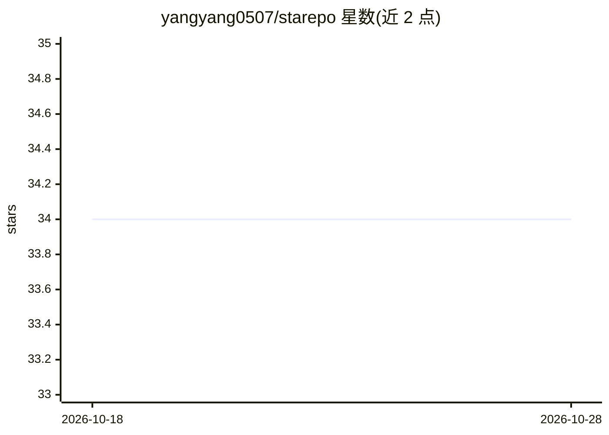

# yangyang0507/starepo

⭐ 34 · TypeScript · MIT · 推送 2026-10-28 · [GitHub](https://github.com/yangyang0507/starepo) · 个人维护 · 中文 README

**用语义搜索检索个人 GitHub star 仓库的 CLI 工具**

面向 GitHub 用户的命令行工具：通过 Device Flow 认证后同步全部 starred 仓库到本地 LanceDB，用本地 embedding（量化版 bge-m3，1024 维，首次缓存约 550MB）生成向量，支持自然语言语义搜索、全文关键词搜索及基于 reciprocal rank fusion 的混合检索；可按 stars/forks/starred 时间排序，支持中英多语言查询，数据全部存本地。另可通过 npx skills 将技能装入 Claude Code、Cursor 等 AI agent 中调用。限制：需 Node.js 22.12+，首次同步含 embedding 约每仓库 0.5 秒。

## 筛选速览

| 维度 | 判定 | 备注 |
|---|---|---|
| AI 角色 | `ai-enhanced` | 去掉 AI 部分产品仍成立 |
| 许可风险 | `permissive` | MIT |
| 部署形态 | `library` | 以包/库形式分发 |
| 模型依赖 | — | README 未给出锁定关系 |
| 硬件要求 | — | 无带数字的原话,不猜 |
| 安装摩擦 | `low` | 无编译、无系统依赖或容器化 |
| 成熟度 | — | 结构信号不足 |

## 能力要点

- 本地 embedding（Xenova/bge-m3 q8）驱动的语义/关键词混合检索
- GitHub Device Flow 认证，无需手动配置 token
- 数据本地存储于 LanceDB，无需编译
- 一条命令安装 AI agent 技能（Claude Code/Cursor 等）

## 适用场景

- 在几百上千个 star 仓库里用自然语言找回目标项目
- 按语言、stars、starred 时间筛选列出仓库
- 让 AI agent 直接代查我的 GitHub stars

## 场景标签

`语义搜索` · 领域:知识与检索

## 证据(README 行号)

> L121: - If embeddings exist: **Hybrid search** (vector + keyword, ranked with reciprocal rank fusion)
> L191: - Local embeddings via quantized `Xenova/bge-m3` q8 (1024-dim, about 550 MB cached on first use)

## 星数曲线

2026-10-18 34 → 2026-10-28 34（+0）

---
*卡片 v1 · prompt 1.4 · 生成 2026-10-25 · 置信度 high · 依据 README sha `24a5cf4e8594` · [字段定义](../../DATASET.md)*
