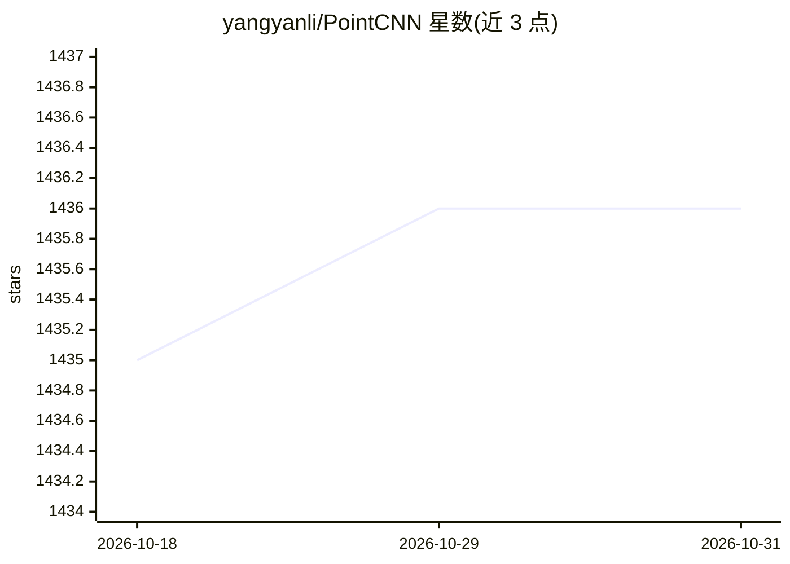

# yangyanli/PointCNN

⭐ 1,436 · Python · NOASSERTION · 推送 2026-03-12 · [GitHub](https://github.com/yangyanli/PointCNN) · [官网](https://arxiv.org/abs/1801.07791) · 组织维护

**点云特征学习的通用卷积框架（NeurIPS 2018）**

PointCNN 提出对点云先做 X-变换再用卷积（X-Conv/X-DeConv）的通用特征学习框架，覆盖分类与分割两类任务，在 ModelNet40、ScanNet、ShapeNet Parts、S3DIS 等基准上提供训练/评估脚本与预训练模型。以 TensorFlow 1.6 的 Python3 脚本实现，依赖 transforms3d、h5py、plyfile 等包；分割任务需先编译最远点采样（FPS）算子。面向从事点云深度学习的研究者与开发者，README 顶部指向后续版本 PointCNN++ 仓库。

## 筛选速览

| 维度 | 判定 | 备注 |
|---|---|---|
| AI 角色 | `ai-native` | 本体是模型或模型工具 |
| 许可风险 | `none` | NOASSERTION |
| 部署形态 | `None` |  |
| 模型依赖 | — | README 未给出锁定关系 |
| 硬件要求 | — | 无带数字的原话,不猜 |
| 安装摩擦 | `low` | 无编译、无系统依赖或容器化 |
| 成熟度 | — | 结构信号不足 |

## 能力要点

- X-Conv/X-DeConv 算子与可配置的 K/D/P/C/links 参数体系
- 多数据集（ModelNet40/ScanNet/ShapeNet/S3DIS/Semantic3D 等）训练与评估脚本
- 提供预训练模型下载
- README 顶部指向后续版本 PointCNN++ 仓库

## 适用场景

- 在 ModelNet40/ScanNet 等基准上复现点云分类与分割实验
- 基于 X-Conv 构建自定义点云网络
- 将点云分割用于 3D 城市/CAD 等应用（如 Esri ArcGIS 集成示例）

## 场景标签

 · 领域:三维计算机视觉/点云深度学习

## 证据(README 行号)

> L13: PointCNN is a simple and general framework for feature learning from point cloud, which refreshed five benchmark re
> L51: The core X-Conv and PointCNN architecture are defined in pointcnn.py.
> L69: PointCNN is implemented and tested with Tensorflow 1.6 in python3 scripts. **Tensorflow before 1.5 version is not r

## 星数曲线

2026-10-18 1,435 → 2026-10-31 1,436（+1）

---
*卡片 v1 · prompt 1.4 · 生成 2026-10-21 · 置信度 high · 依据 README sha `b6a137dbe64b` · [字段定义](../../DATASET.md)*
