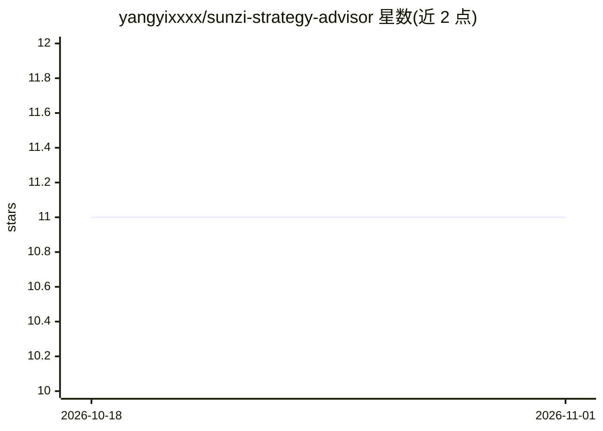

# yangyixxxx/sunzi-strategy-advisor

⭐ 11 · MIT · 推送 2026-07-28 · [GitHub](https://github.com/yangyixxxx/sunzi-strategy-advisor) · 个人维护 · 中文 README

**把《孙子兵法》执行为决策纪律的 AI Skill，输出战略诊断**

面向 Claude Code / NewMax 等长上下文模型的 AI Skill，由四个 markdown 文件构成，不依赖代码或 API。工作流为：第 0 步按可逆性/资源占用/路径依赖判断是否战略级问题；第 1 步先问 3–5 个关键问题并停下等待回答（不算不打）；随后按六诊（对应十三篇）诊断，输出含打/不打/待三选项、按概率排序的失败模式与校准点的结构化诊断文档。附八条铁律约束，明示不适用财务建模、法律合规与需要真实数据的场景。

## 筛选速览

| 维度 | 判定 | 备注 |
|---|---|---|
| AI 角色 | `ai-native` | 本体是模型或模型工具 |
| 许可风险 | `permissive` | MIT |
| 部署形态 | `None` |  |
| 模型依赖 | — | README 未给出锁定关系 |
| 硬件要求 | — | 无带数字的原话,不猜 |
| 安装摩擦 | `low` | 无编译、无系统依赖或容器化 |
| 成熟度 | — | 结构信号不足 |

## 能力要点

- 先问询后诊断：信息不足时只提问不给方案
- 六诊流程对应十三篇，输出结构化诊断文档
- 八条铁律（不算不打、先问能不能不打、给"待"选项等）
- 纯 markdown 实现，可直接贴给任意长上下文模型运行

## 适用场景

- 判断要不要进入某个市场或打这一仗
- 对已有战略方案做压力测试
- 重大决策复盘，定位认知/布局/组织等问题

## 场景标签

 · 领域:决策支持/战略咨询

## 证据(README 行号)

> L3: > 一个把《孙子兵法》当作**决策纪律**来执行的 AI Skill——不是当语录来引用。
> L30: 第 1 步  庙算问询 ── 3–5 个关键问题，问完停下等你回答（最重要的一步，不许跳过）
> L99: 这个 Skill 本质上是四个 markdown 文件，不依赖任何代码、脚本或 API。把 `SKILL.md` 连同 `references/` 下的三个文件一起贴给任何长上下文模型，也能跑起来——只是没有自动触发和文件落盘。

## 星数曲线

2026-10-18 11 → 2026-11-01 11（+0）

---
*卡片 v1 · prompt 1.4 · 生成 2026-11-01 · 置信度 high · 依据 README sha `62a6e0217ded` · [字段定义](../../DATASET.md)*
