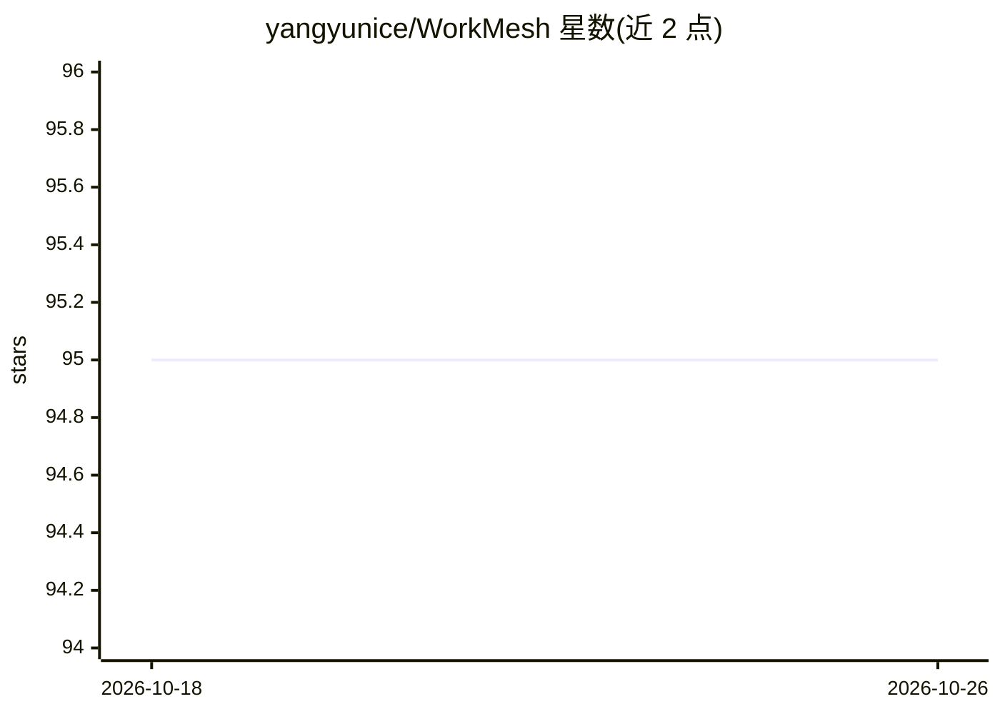

# yangyunice/WorkMesh

⭐ 95 · TypeScript · MIT · 推送 2026-06-02 · [GitHub](https://github.com/yangyunice/WorkMesh) · 个人维护 · 中文 README

**开源 AI 时代就业平台原型：连接个人、企业、治理与 AI 助手**

可本地运行的多门户就业协作系统原型，包含个人门户（AI 工作台、技能画像、任务与收入看板）、企业门户（招聘、供需协作、履约配额）、治理门户（就业分析、风险监控、闭环处置）与移动注册门户，共享一套 NestJS + Prisma API 和 PostgreSQL 数据库。已实现基于技能标签/地区/经验的匹配打分、关键词 RAG、Skills 路由与调用审计；向量检索、模型编排、地理半径搜索等列为未来方向。README 自述为原型，作者非职业工程师，代码大量借助 AI 完成，现实落地需政府或大型组织背书。通过 ./deploy.sh 或 ./start-local-demo.sh 本地启动。

## 筛选速览

| 维度 | 判定 | 备注 |
|---|---|---|
| AI 角色 | `ai-enhanced` | 去掉 AI 部分产品仍成立 |
| 许可风险 | `permissive` | MIT |
| 部署形态 | `self-host` | docker 或自建部署 |
| 模型依赖 | — | README 未给出锁定关系 |
| 硬件要求 | — | 无带数字的原话,不猜 |
| 安装摩擦 | `low` | 无编译、无系统依赖或容器化 |
| 成熟度 | `idea` | |

## 能力要点

- 四门户 + 共享 API + PostgreSQL 的多端架构，注册一次生成唯一关联画像
- 已实现技能标签匹配打分、关键词 RAG、Agent Skills 路由与调用审计
- 治理端提供国家/省/市/区分层视角与风险、任务视图
- AI 助手可调用平台业务 API 而非孤立聊天窗口，推荐结合用户当前状态

## 适用场景

- 探索 AI 转型期失业人群的就业支持与技能学习路径系统
- 企业发布岗位后按技能标签获得候选人匹配
- 治理团队监控就业运行指标、风险事件并走闭环处置流程

## 场景标签

`AI 助手` `RAG` · 领域:对话与助手

## 证据(README 行号)

> L31: 5. AI assistants can retrieve platform knowledge and invoke role-aware business capabilities.
> L75: - **AI is more than a chat window.** Assistants can retrieve knowledge and route requests to business Skills.
> L118: |AI assistants|Keyword RAG, Skills routing, and invocation audits implemented|Add model orchestration, vector retr

## 星数曲线

2026-10-18 95 → 2026-10-26 95（+0）

---
*卡片 v1 · prompt 1.4 · 生成 2026-10-23 · 置信度 mid · 依据 README sha `cb6cccc1ac53` · [字段定义](../../DATASET.md)*
