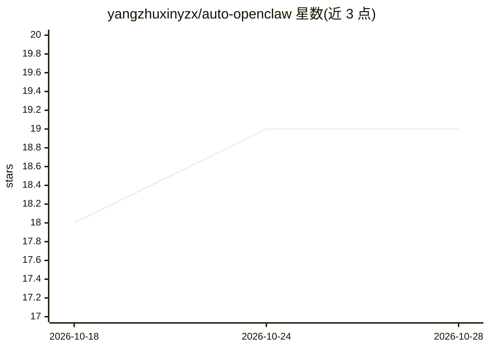

# yangzhuxinyzx/auto-openclaw

⭐ 19 · TypeScript · Apache-2.0 · 推送 2026-02-17 · [GitHub](https://github.com/yangzhuxinyzx/auto-openclaw) · [官网](https://github.com/bytedance/UI-TARS-desktop) · 个人维护 · 中文 README

**让 OpenClaw 获得桌面操作能力的 UI-TARS skill 集成**

基于 UI-TARS Desktop v0.3.0-beta.11 修改的集成项目：将 UI-TARS CLI 封装为 OpenClaw 的 skill，使其 agent 能通过截屏、VLM 推理与 nut-js 执行鼠标键盘操作。用户在 OpenClaw 对话中下达 GUI 任务即可驱动桌面自动化。需 Node.js 20+、pnpm 与任意 OpenAI 兼容的 VLM API（README 推荐火山引擎 doubao-seed-2-0-pro-260215）。新增 JSON Lines 结构化输出、退出码与最终截图保存；CLI 通过 git clone 源码构建安装。

## 筛选速览

| 维度 | 判定 | 备注 |
|---|---|---|
| AI 角色 | `ai-ecosystem` | LLM/agent 周边工具 |
| 许可风险 | `permissive` | Apache-2.0 |
| 部署形态 | `library` | 以包/库形式分发 |
| 模型依赖 | — | README 未给出锁定关系 |
| 硬件要求 | — | 无带数字的原话,不猜 |
| 安装摩擦 | `low` | 无编译、无系统依赖或容器化 |
| 成熟度 | — | 结构信号不足 |

## 能力要点

- 将 UI-TARS CLI 封装为 OpenClaw 可自动加载的 skill
- 截屏→VLM 推理→nut-js 执行的循环式 GUI 自动化
- JSON Lines 事件流输出（screenshot/prediction/error/done）与 4 类退出码
- 支持任意 OpenAI 兼容的视觉语言模型 API

## 适用场景

- 通过对话让 OpenClaw 代替我操作桌面软件
- 用自然语言执行浏览器访问、微信发消息等 GUI 任务
- 为 agent 框架扩展 computer-use 能力

## 场景标签

`GUI 自动化` · 领域:效率与自动化

## 证据(README 行号)

> L5: 本项目基于 UI-TARS Desktop（v0.3.0-beta.11）修改，将其 CLI 作为 OpenClaw 的 skill 接入，让 OpenClaw 能够像人一样看屏幕、点鼠标、打键盘。
> L10: 用户 → OpenClaw → ui-tars skill → UI-TARS CLI → 截屏 → VLM 推理 → 执行操作 → 循环

## 星数曲线

2026-10-18 18 → 2026-10-28 19（+1）

---
*卡片 v1 · prompt 1.4 · 生成 2026-10-28 · 置信度 mid · 依据 README sha `be8a15eeca08` · [字段定义](../../DATASET.md)*
