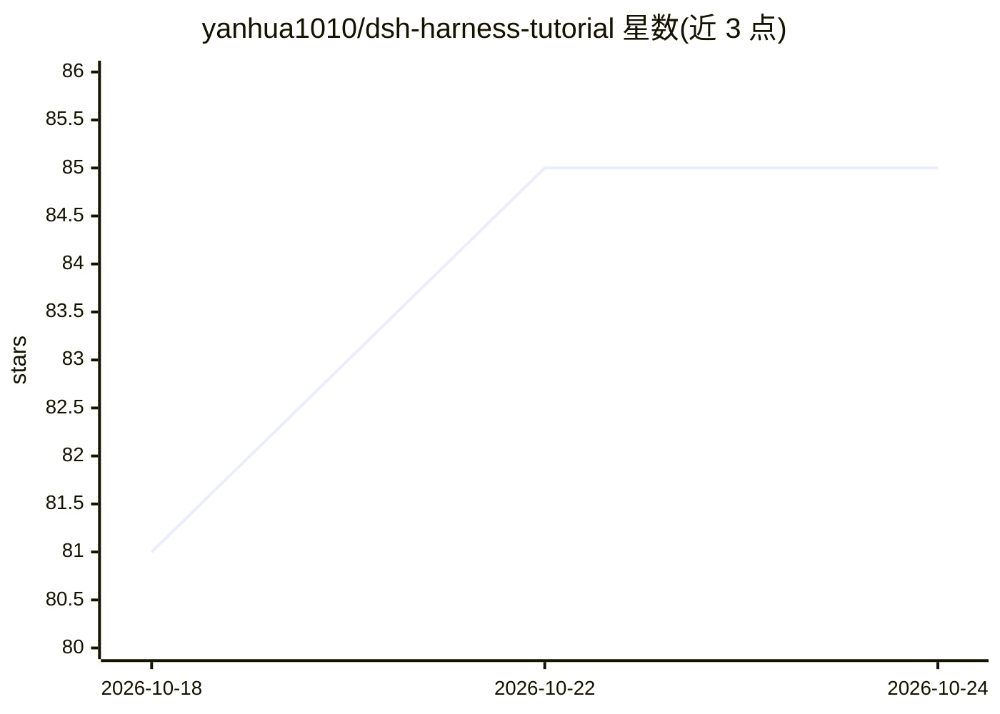

# yanhua1010/dsh-harness-tutorial

⭐ 85 · TypeScript · MIT · 推送 2026-08-13 · [GitHub](https://github.com/yanhua1010/dsh-harness-tutorial) · 个人维护 · 中文 README

**DeepSeek Harness 中文教程站：原理讲解 + 8 个 Demo + mini-harness 实现**

一个 VitePress 中文教学站点，面向计算机本科毕业生，讲解 DeepSeek Harness（「一切皆插件」的 Agent 框架）的原理与实现：8 章原理篇、8 个可运行 Demo，以及一个教学版 mini-harness 项目（React 前端 + Node.js TypeScript 后端）。通过 npm 安装依赖并本地运行，站点已部署到 GitHub Pages。版本锁定 DeepSeek Harness 0.1.0-rc.6、Cordis 4.0.1、Node.js ≥ 20.19，所有 Demo 在该版本上验证，项目处于快速迭代期。

## 筛选速览

| 维度 | 判定 | 备注 |
|---|---|---|
| AI 角色 | `ai-knowledge` | 知识聚合/清单类 |
| 许可风险 | `permissive` | MIT |
| 部署形态 | `library` | 以包/库形式分发 |
| 模型依赖 | locked-api |  |
| 硬件要求 | — | 无带数字的原话,不猜 |
| 安装摩擦 | `low` | 无编译、无系统依赖或容器化 |
| 成熟度 | `idea` | |

## 能力要点

- VitePress 中文教程站点，含 8 章原理篇
- 8 个真实可运行 Demo
- 教学版 mini-harness 目标项目（React + Node.js TypeScript）
- Demo 均在锁定版本（DSH 0.1.0-rc.6）上实际运行验证

## 适用场景

- 系统学习 DeepSeek Harness 的插件化 Agent 机制
- 跟随 Demo 动手理解 Agent 框架各组件
- 作为本科毕业生从零实现教学版 Agent 框架的路线图

## 场景标签

 · 领域:AI 开发教育/教程

## 证据(README 行号)

> L3: 一个完整可运行的 VitePress 中文教学站点，把 DeepSeek Harness（「一切皆插件」的 Agent 框架）拆解成一套适合计算机本科毕业生的渐进式教程：先懂原理，再用 8 个真实可运行的 Demo 掌握机制，最后亲
> L31: - DeepSeek Harness（开发者预览）：`0.1.0-rc.6`

## 星数曲线

2026-10-18 81 → 2026-10-24 85（+4）

---
*卡片 v1 · prompt 1.4 · 生成 2026-10-24 · 置信度 high · 依据 README sha `b645f95ff3fd` · [字段定义](../../DATASET.md)*
