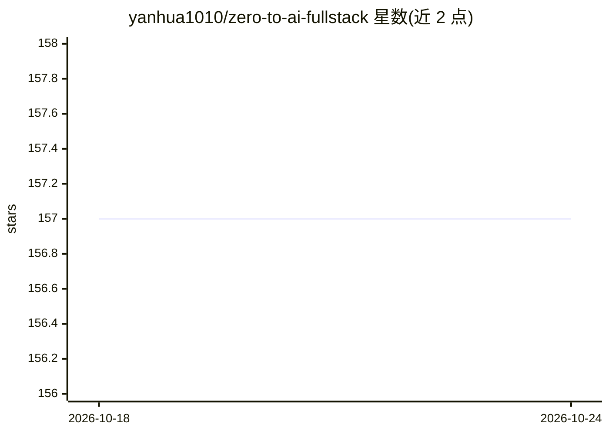

# yanhua1010/zero-to-ai-fullstack

⭐ 157 · Python · MIT · 推送 2026-06-01 · [GitHub](https://github.com/yanhua1010/zero-to-ai-fullstack) · 个人维护 · 中文 README

**Java 工程师公开学习 AI 全栈的自托管 RAG 知识库**

一位有 8 年经验的 Java 后端工程师公开学习 AI 全栈的项目：从零构建可自托管的知识库，支持上传文档、提问并获得带来源引用的回答。技术栈为 Python · FastAPI · LangChain · PostgreSQL/pgvector · Next.js · Docker，按 8 周路线图推进，前 4 周（Python/Claude API、LangChain 文档处理、pgvector 向量检索、完整 RAG 管线）已完成，RAG 优化与 Docker 部署尚未进行。通过 git clone 与 uv 安装运行。

## 筛选速览

| 维度 | 判定 | 备注 |
|---|---|---|
| AI 角色 | `ai-native` | 本体是模型或模型工具 |
| 许可风险 | `permissive` | MIT |
| 部署形态 | `None` |  |
| 模型依赖 | — | README 未给出锁定关系 |
| 硬件要求 | — | 无带数字的原话,不猜 |
| 安装摩擦 | `low` | 无编译、无系统依赖或容器化 |
| 成熟度 | `idea` | |

## 能力要点

- 上传文档、提问、返回带来源引用的回答
- FastAPI + LangChain + pgvector + Next.js 技术栈
- 8 周学习路线图与每周学习日志
- 自托管部署形态

## 适用场景

- 搭建自己的文档问答知识库
- 参考 Java 工程师转 AI 全栈的学习路径与实现
- 了解 FastAPI + pgvector 构建 RAG 的完整管线

## 场景标签

 · 领域:LLM 应用/知识库问答

## 证据(README 行号)

> L5: A Java backend engineer's attempt at AI full-stack. Building a RAG knowledge base from scratch, one week at a time.
> L15: A self-hostable RAG knowledge base: upload documents, ask questions, get answers with source citations.
> L24: Stack: Python · FastAPI · LangChain · PostgreSQL · pgvector · Next.js · Docker

## 星数曲线

2026-10-18 157 → 2026-10-24 157（+0）

---
*卡片 v1 · prompt 1.4 · 生成 2026-10-22 · 置信度 mid · 依据 README sha `d9454685dadb` · [字段定义](../../DATASET.md)*
