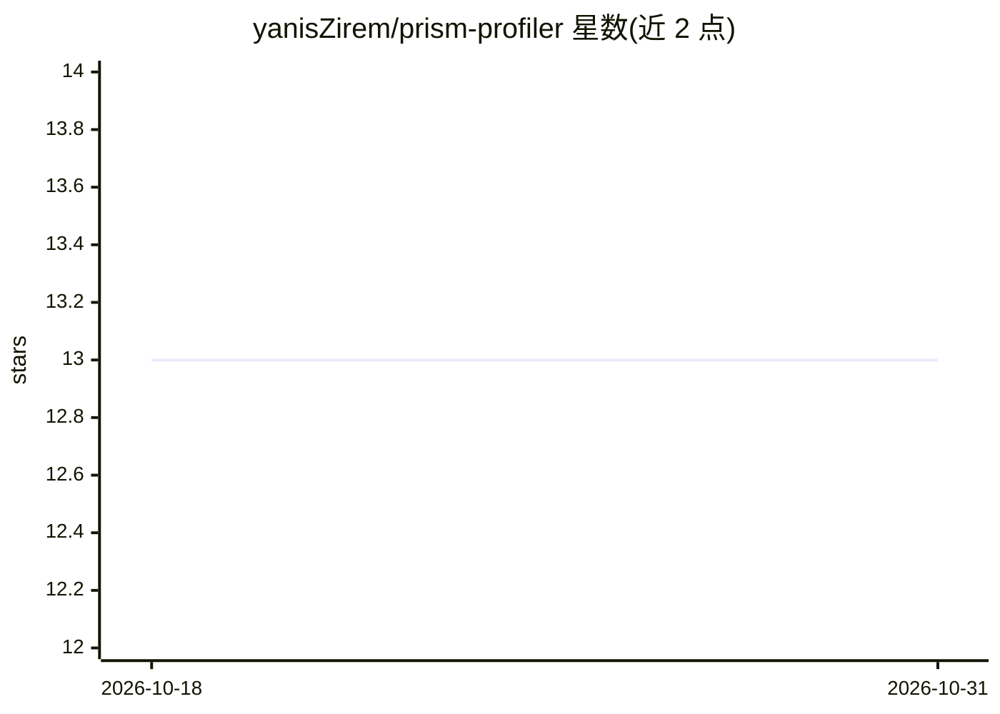

# yanisZirem/prism-profiler

⭐ 13 · Python · NOASSERTION · 推送 2026-10-22 · [GitHub](https://github.com/yanisZirem/prism-profiler) · [官网](https://prism-profiler.univ-lille.fr/) · 组织维护

**本地离线运行的多组学数据分析桌面平台**

Profiler 桌面版是完全离线运行的多组学数据交互分析平台：数据不出本机、无上传无账号。功能包括 GSEA 富集分析（对接 100+ 数据库）、含 ML 与 MLP 的连续目标回归建模、纵向数据混合效应模型、一键导出自包含 HTML 报告、以 _meta 结尾列作为临床协变量的元数据支持；支持 Spectronaut、FragPipe、DESeq2/edgeR、XCMS、MZmine 等多种格式。附带质谱成像预处理工具 MSI2Profiler（.imzML 转 CSV）。面向 Windows 10/11，通过 Conda 环境一键安装，软件本身为 APP 注册的专有许可，由 INSERM/里尔大学 PRISM 实验室开发。

## 筛选速览

| 维度 | 判定 | 备注 |
|---|---|---|
| AI 角色 | `ai-enhanced` | 去掉 AI 部分产品仍成立 |
| 许可风险 | `none` | NOASSERTION |
| 部署形态 | `desktop` | 安装包/桌面程序 |
| 模型依赖 | — | README 未给出锁定关系 |
| 硬件要求 | — | 无带数字的原话,不猜 |
| 安装摩擦 | `low` | 无编译、无系统依赖或容器化 |
| 成熟度 | — | 结构信号不足 |

## 能力要点

- 完全本地离线运行，无上传与联网要求
- GSEA/ORA 富集分析对接 100+ 数据库
- ML 与 MLP 回归建模，含 R²、RMSE、交叉验证
- MSI2Profiler 伴生工具处理 .imzML 质谱成像数据

## 适用场景

- 在本地分析蛋白质组/代谢组等多组学数据，数据不出实验室
- 对组学输出做 GSEA 富集与回归建模分析
- 一键导出会话图表与指标为 HTML 报告

## 场景标签

`数据分析` · 领域:效率与自动化

## 证据(README 行号)

> L19: **Profiler Desktop v1.2** is the standalone, fully offline version of Profiler — an interactive platform for multi-
> L34: - **Regression modeling** — ML and MLP for continuous targets; R², RMSE, residual plots, cross-validation

## 星数曲线

2026-10-18 13 → 2026-10-31 13（+0）

---
*卡片 v1 · prompt 1.4 · 生成 2026-10-31 · 置信度 mid · 依据 README sha `16bd50db3a44` · [字段定义](../../DATASET.md)*
