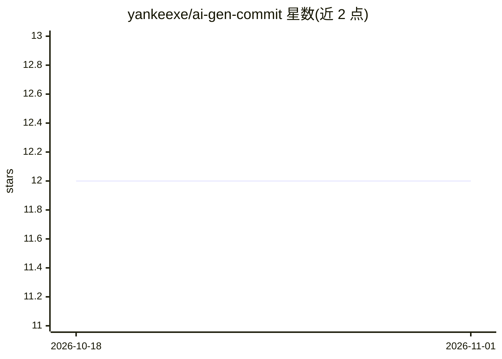

# yankeexe/ai-gen-commit

⭐ 12 · Python · MIT · 推送 2026-10-06 · [GitHub](https://github.com/yankeexe/ai-gen-commit) · [官网](https://pypi.org/project/ai-gen-commit) · 个人维护

**用 AI 为暂存的代码改动生成提交信息的命令行工具**

Python 编写的 CLI 工具：在含暂存改动的 git 目录中运行 aic 命令，读取 diff 并调用大模型生成提交信息，支持重新生成与在 $EDITOR 中就地编辑。模型接入有三种方式：本地经 Ollama 运行（默认本地模式）、远程经 OpenAI API 兼容服务商（openai/groq/gemini/togetherai/deepseek 等）、或自定义 OpenAI 兼容端点。可通过项目级或全局 .ai-commit 文件自定义系统提示词与提交信息格式。pip 安装，无桌面构建。

## 筛选速览

| 维度 | 判定 | 备注 |
|---|---|---|
| AI 角色 | `ai-native` | 本体是模型或模型工具 |
| 许可风险 | `permissive` | MIT |
| 部署形态 | `library` | 以包/库形式分发 |
| 模型依赖 | local-ok | 支持本地模型 |
| 硬件要求 | — | 无带数字的原话,不猜 |
| 安装摩擦 | `low` | 无编译、无系统依赖或容器化 |
| 成熟度 | — | 结构信号不足 |

## 能力要点

- 本地 Ollama 或 OpenAI 兼容远程服务商生成提交信息
- 支持自定义 OpenAI 兼容 Provider（自定义 BASE_URL）
- 重新生成与 $EDITOR 就地编辑生成的提交信息
- 项目级/全局系统提示词自定义提交信息格式

## 适用场景

- 写提交信息时让 AI 根据 diff 自动生成初稿
- 在离线环境用本地模型生成提交信息
- 团队统一提交信息格式（自定义系统提示词）

## 场景标签

 · 领域:开发者工具/git 工作流

## 证据(README 行号)

> L3: Use AI to generate commit message for your staged changes.
> L11: - Use local models (via Ollama) or remote models (with OpenAI API compatible providers like: `openai`, `groq`, `gem

## 星数曲线

2026-10-18 12 → 2026-11-01 12（+0）

---
*卡片 v1 · prompt 1.4 · 生成 2026-10-31 · 置信度 high · 依据 README sha `d2a8be9a9b48` · [字段定义](../../DATASET.md)*
