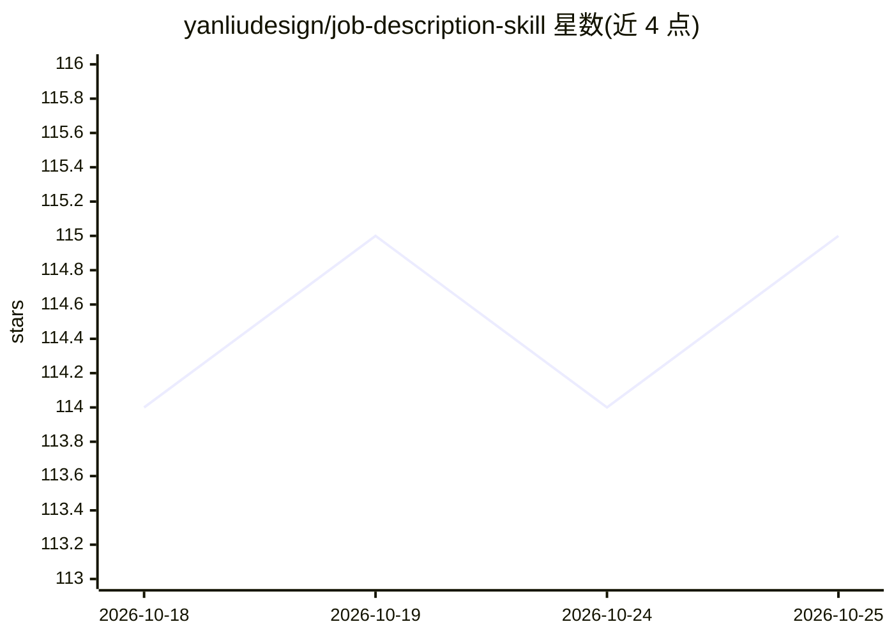

# yanliudesign/job-description-skill

⭐ 115 · 推送 2026-07-24 · [GitHub](https://github.com/yanliudesign/job-description-skill) · 个人维护 · 中文 README

**解析职位描述并生成求职策略报告的 Claude 技能**

一个以 SKILL.md 格式提供的 Claude skill：用户粘贴 JD 与简历，技能经解码、匹配、简历定制、面试预测、是否申请判定 5 个内部流程，在桌面生成单文件 HTML 的 Offer Strategy 报告，含 10 个固定章节（公司背景、逐条匹配矩阵、差距卡、薪资核验、Top 10 面试题、6 周行动计划等），支持页内导出 PDF/Markdown。面向使用 Claude Code 等 agent 客户端的求职者，属于 offer-toolkit 三件套之一，需在 Claude 环境中调用，报告依赖简历提供的真实证据，缺失即标记。

## 筛选速览

| 维度 | 判定 | 备注 |
|---|---|---|
| AI 角色 | `ai-native` | 本体是模型或模型工具 |
| 许可风险 | `none` | — |
| 部署形态 | `None` |  |
| 模型依赖 | — | README 未给出锁定关系 |
| 硬件要求 | — | 无带数字的原话,不猜 |
| 安装摩擦 | `low` | 无编译、无系统依赖或容器化 |
| 成熟度 | — | 结构信号不足 |

## 能力要点

- 5 个内部流程（Decode/Match/Tailor/Predict/Should I Apply）汇总为单文件 HTML 报告
- 固定 10 章节框架：匹配矩阵、差距卡、薪资核验、Top 10 面试题、6 周行动计划
- 支持 CJK 字体嵌入的 PDF 导出与 Markdown 导出
- 三项规则约束：先解码、不虚构经历、单一任务

## 适用场景

- 投递前判断某个岗位是否值得申请
- 逐条比对 JD 要求与自己简历的匹配度与差距
- 提前准备该岗位可能被问到的面试问题
- 获得从投递到面试的逐周行动清单

## 场景标签

 · 领域:职业发展/求职工具

## 证据(README 行号)

> L20: A Claude skill for reading job descriptions. Give it a JD and your resume, and it hands back an HTML report telling
> L31: 3. **HTML report auto-opens** — a single-file Offer Strategy Report is generated to `~/Desktop/Claude skills/offer-

## 星数曲线

2026-10-18 114 → 2026-10-25 115（+1）

---
*卡片 v1 · prompt 1.4 · 生成 2026-10-23 · 置信度 high · 依据 README sha `e8f9cf4c0965` · [字段定义](../../DATASET.md)*
