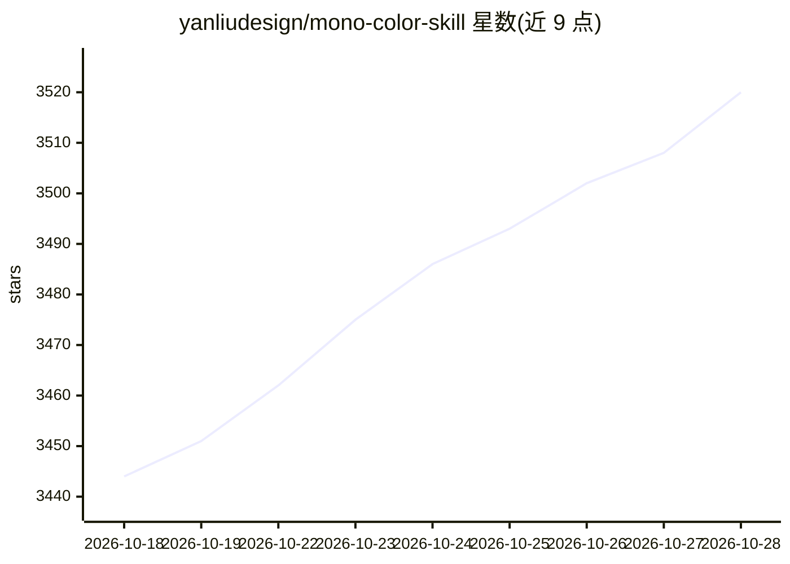

# yanliudesign/mono-color-skill

⭐ 3,533 · Python · MIT · 推送 2026-09-02 · [GitHub](https://github.com/yanliudesign/mono-color-skill) · 个人维护 · 中文 README

**给 Claude 用户的单色/双色版画风格图像生成技能**

面向 Claude Code 的 SKILL.md 格式图像生成技能：把主题、语句、物体或照片转化为海报、zine、包装等编辑风格的版画图像。默认受控双墨（主版占 70%–85%），支持纯单墨、网目调、risograph 颗粒、蓝晒等模式，规定 25%–55% 留白与排版规则；每次运行输出位图、可复用的生产级 prompt 与配方清单。无图像生成工具时退回仅输出 prompt。安装方式为 git clone 到 ~/.claude/skills 目录，也可被其他 agent 环境加载。

## 筛选速览

| 维度 | 判定 | 备注 |
|---|---|---|
| AI 角色 | `ai-native` | 本体是模型或模型工具 |
| 许可风险 | `permissive` | MIT |
| 部署形态 | `None` |  |
| 模型依赖 | locked-api |  |
| 硬件要求 | — | 无带数字的原话,不猜 |
| 安装摩擦 | `low` | 无编译、无系统依赖或容器化 |
| 成熟度 | — | 结构信号不足 |

## 能力要点

- 单墨/受控双墨体系，8 种单墨色与 9 组双墨配方（含精确 Hex）
- 规定 25%–55% 留白、非对称编辑网格与 7 条视觉规则
- 输出位图 + 生产级 prompt + 配方（模式/墨色/版式/字体搭配）
- 请求先解析为确定性配方清单，未指定项有默认值

## 适用场景

- 做活动海报、展览海报或 zine 封面
- 为小红书封面、播客封面、公众号头图生成单墨风格图
- 把旅行照片转成明信片系列或纪念卡片
- 低成本单墨印刷品设计

## 场景标签

`图像生成` · 领域:内容生成

## 证据(README 行号)

> L15: Turn a theme, sentence, object, or supplied photograph into an original editorial image. The skill defaults to cont
> L220: One run returns:

## 星数曲线

2026-10-18 3,444 → 2026-10-28 3,520（+76）

---
*卡片 v1 · prompt 1.4 · 生成 2026-10-20 · 置信度 high · 依据 README sha `532f943f459c` · [字段定义](../../DATASET.md)*
