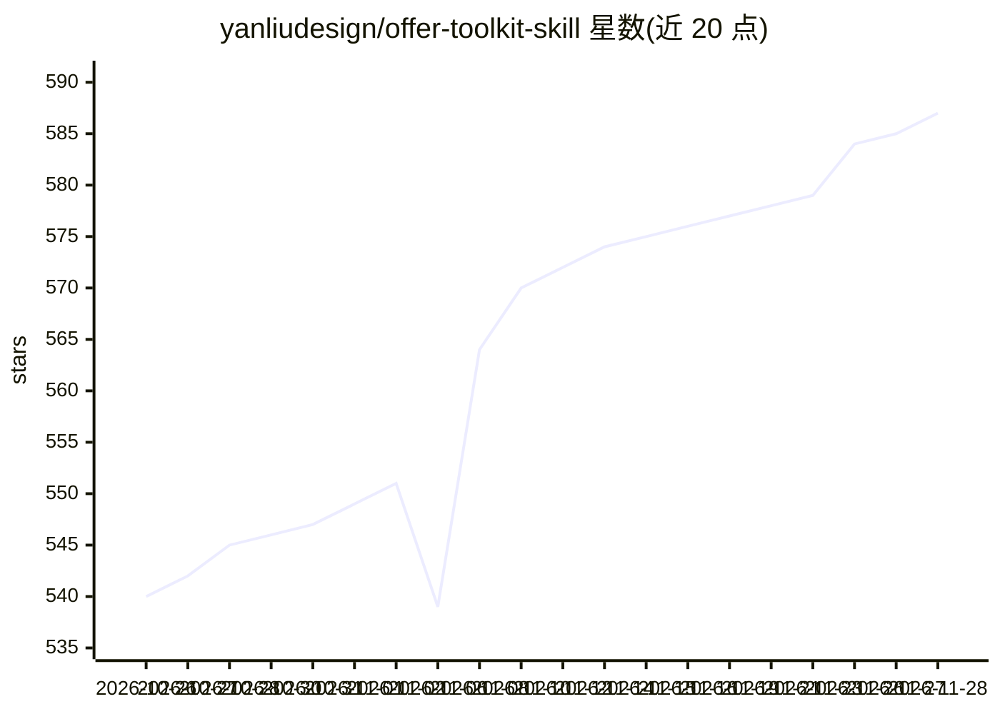

# yanliudesign/offer-toolkit-skill

⭐ 587 · HTML · MIT · 推送 2026-10-27 · [GitHub](https://github.com/yanliudesign/offer-toolkit-skill) · 个人维护 · 中文 README

**面向求职者的 Claude 技能包：六个求职工具加顶层路由**

将六个求职工具打包为一个 agent skill pack，覆盖职位发现、JD 解码、简历制作、行为面试准备、offer 对比与薪资谈判六个阶段。每个子技能自带 SKILL.md 可独立安装使用，顶层路由器按意图分发到对应工作流。输出为本地 HTML 报告、简历或故事库，用户需具备支持 SKILL.md 格式的 AI 客户端。内置四条共享规则：内容不编造、只问影响答案的问题、先结构后渲染、不代用户提交申请或发消息。

## 筛选速览

| 维度 | 判定 | 备注 |
|---|---|---|
| AI 角色 | `ai-native` | 本体是模型或模型工具 |
| 许可风险 | `permissive` | MIT |
| 部署形态 | `None` |  |
| 模型依赖 | — | README 未给出锁定关系 |
| 硬件要求 | — | 无带数字的原话,不猜 |
| 安装摩擦 | `low` | 无编译、无系统依赖或容器化 |
| 成熟度 | — | 结构信号不足 |

## 能力要点

- 六阶段求职工具打包：搜索、JD 解码、简历（12 个打印就绪模板）、行为面试、offer 对比、薪资谈判
- 顶层 SKILL.md 路由器按触发短语分发到六个子技能，子技能可单独安装
- 行为面试技能以 STAR/CAR 结构挖掘真实经历，中英双语保存故事库
- 生成文件保留在本地（HTML 报告/简历/故事库）

## 适用场景

- 解码职位描述并生成是否值得投递的评估报告
- 按 12 个模板定制与美化简历并导出 PDF
- 挖据个人经历建立可复用的行为面试故事库
- 对比多个 offer 的四年 TC、成长与风险并获得建议

## 场景标签

 · 领域:职业发展/求职工具

## 证据(README 行号)

> L23: Six job-hunting tools bundled as an agent skill pack. Use the whole thing, or just the piece you need — each sub-fo
> L82: Copy the whole `offer-toolkit-skill/` folder into your client's supported skills directory, preserving the top-leve
> L40:  job&#8209;hunt&#8209;skill Give it a resume, target direction, seed JD, or existing job links. It searches public 

## 星数曲线

2026-10-26 540 → 2026-11-28 587（+47）

---
*卡片 v1 · prompt 1.4 · 生成 2026-11-25 · 置信度 high · 依据 README sha `d37f3416ab80` · [字段定义](../../DATASET.md)*
