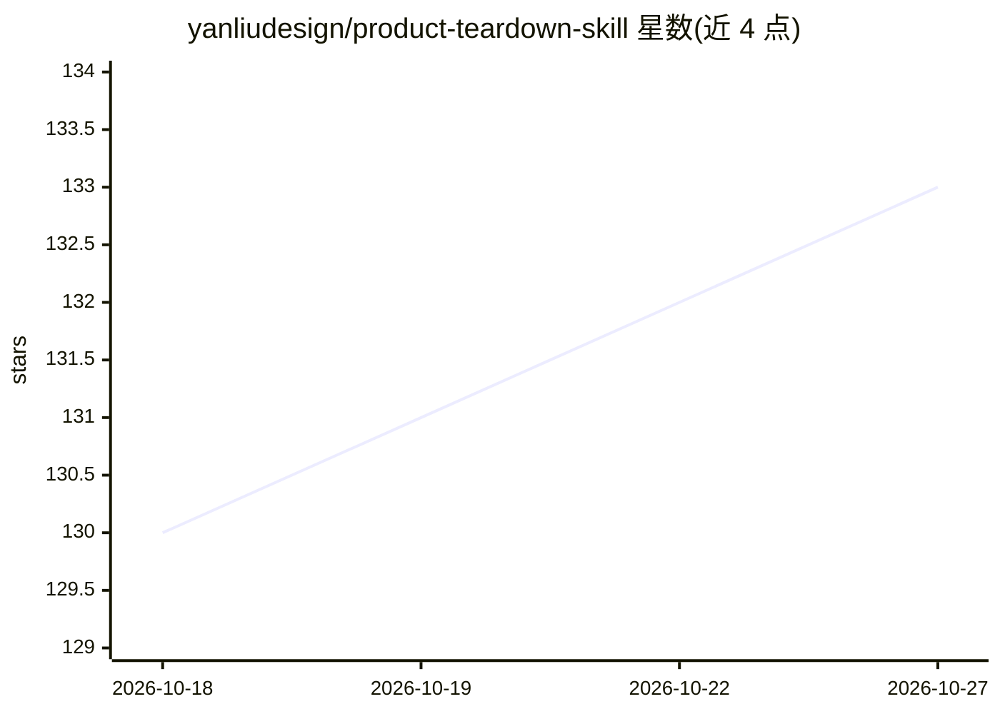

# yanliudesign/product-teardown-skill

⭐ 133 · Python · 推送 2026-07-23 · [GitHub](https://github.com/yanliudesign/product-teardown-skill) · 个人维护 · 中文 README

**面向产品经理的产品拆解提示词技能：生成双语 HTML 拆解报告**

以可移植提示词（SKILL/prompt 文件）形式提供的产品拆解技能，运行于 Claude Code、Codex、OpenCode 等 agent 工具中。用户以一句话指定任意产品，技能按固定的 11 段结构（快照、用户与 JTBD、核心循环、架构、商业模式、增长、AI 就绪度等）产出聊天回复，并自动生成中英双语、可打印的单文件 HTML 报告（存至桌面目录），内嵌取自产品 og:image 营销素材的 6 图截图廊。报告模板使用大写占位符填充，页脚含品牌标记且不可移除。

## 筛选速览

| 维度 | 判定 | 备注 |
|---|---|---|
| AI 角色 | `ai-ecosystem` | LLM/agent 周边工具 |
| 许可风险 | `none` | — |
| 部署形态 | `None` |  |
| 模型依赖 | — | README 未给出锁定关系 |
| 硬件要求 | — | 无带数字的原话,不猜 |
| 安装摩擦 | `low` | 无编译、无系统依赖或容器化 |
| 成熟度 | — | 结构信号不足 |

## 能力要点

- 固定 11 段拆解结构（Snapshot → Final PM Verdict）
- 同一次运行生成中英双语、互链、可打印的单文件 HTML 报告
- 截图从产品自身 og:image 资产抓取（curl + grep）
- 可移植：提示词文件可粘贴到任意工具或作为 VS Code 斜杠命令

## 适用场景

- 让 AI 帮我系统拆解一个竞品或研究对象
- 快速产出结构化的双语产品分析报告用于汇报
- 学习 Principal PM 视角的产品拆解框架

## 场景标签

`提示工程` `AI 写作` · 领域:Agent 开发

## 证据(README 行号)

> L17: A Principal-PM-level product-teardown skill. Point it at any product (Linear, Notion, Cursor, Perplexity…) and it r
> L71: ├── product-teardown-prompt.md              # Portable skill prompt (paste into any tool)
> L84: Copy product-teardown-prompt.md into your VS Code prompts folder as `product-teardown.prompt.md` and invoke via `/p

## 星数曲线

2026-10-18 130 → 2026-10-27 133（+3）

---
*卡片 v1 · prompt 1.4 · 生成 2026-10-22 · 置信度 mid · 依据 README sha `b96b1bf82a11` · [字段定义](../../DATASET.md)*
