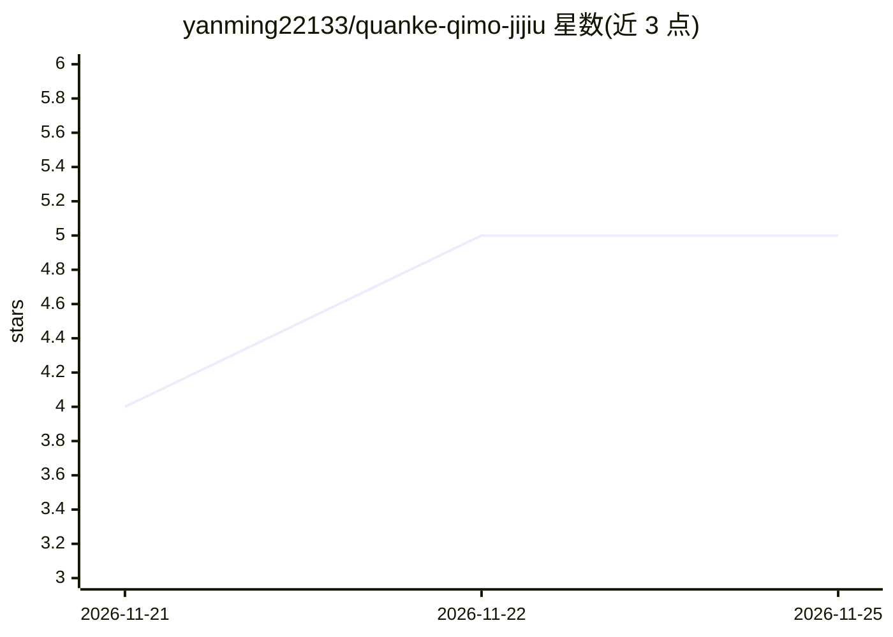

# yanming22133/quanke-qimo-jijiu

⭐ 5 · HTML · MIT · 推送 2026-11-21 · [GitHub](https://github.com/yanming22133/quanke-qimo-jijiu) · 个人维护 · 中文 README

**给学生用 AI Agent 从课件教材生成可打印复习资料**

ReviewCraft 是一套供 AI Agent 使用的工作流包（Skill），由 SKILL.md、Markdown 参考文档与 Python 校验脚本组成，不含独立程序与服务端。用户提交课件、教材、录音、往年题后，Agent 先提取题型分值、考试范围、命题依据等情报，再生成 LaTeX 排版的知识点汇总、章节练习、默认 5 套模拟卷及答案册，并带留白检查、sympy 复算、跨卷去重等质量闸门。运行需自行提供支持读文件、跑命令的 Agent，以及 TeX Live 与 Python 3.9+。

## 筛选速览

| 维度 | 判定 | 备注 |
|---|---|---|
| AI 角色 | `ai-native` | 本体是模型或模型工具 |
| 许可风险 | `permissive` | MIT |
| 部署形态 | `None` |  |
| 模型依赖 | — | README 未给出锁定关系 |
| 硬件要求 | — | 无带数字的原话,不猜 |
| 安装摩擦 | `low` | 无编译、无系统依赖或容器化 |
| 成熟度 | — | 结构信号不足 |

## 能力要点

- 先提取考试情报（题型、范围、命题依据）再生成，缺项先问不猜
- 默认产出 2+2N 个文件：知识点汇总、章节练习、5 套模拟卷+答案册
- 质量闸门：Python/sympy 复算、留白脚本检查、跨卷去重、难度分布 40/40/20
- 支持复盘模式：上传答卷照片/PDF 判错因并出补弱卷

## 适用场景

- 期末前把课件、教材、录音做成一套可打印复习资料
- 按工科/文科/医学等课程类型生成对应评分逻辑的模拟卷
- 上传做过的卷子，定位薄弱知识点并生成补弱变式题
- 按考试日期倒排生成每日复习计划与考前速查卡

## 场景标签

`提示工程` · 领域:Agent 开发

## 证据(README 行号)

> L7: ReviewCraft 是一套给 **AI Agent** 用的工作流包（Skill），**不绑定任何客户端**：对话式 Agent、CLI Agent、IDE 里的助手、本地模型都可以，只要它能读文件、能跑命令。它不是一个独立程序
> L3: > 全科复习资料生成器：把课件、教材、录音、往年题，变成一套**能直接打印**的复习资料——知识点汇总、章节练习、3–5 套模拟卷 + 答案。

## 星数曲线

2026-11-21 4 → 2026-11-25 5（+1）

---
*卡片 v1 · prompt 1.4 · 生成 2026-11-21 · 置信度 high · 依据 README sha `0b8116800b98` · [字段定义](../../DATASET.md)*
