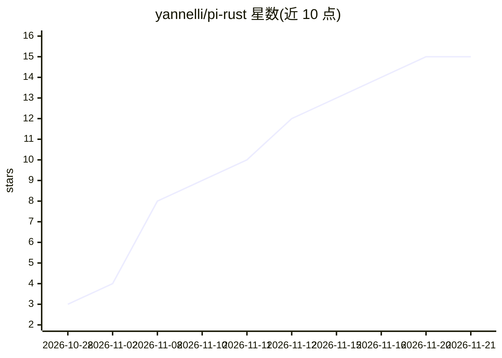

# yannelli/pi-rust

⭐ 15 · Rust · MIT · 推送 2026-11-19 · [GitHub](https://github.com/yannelli/pi-rust) · [官网](https://ryanyannelli.com/projects/pi-rust/) · 个人维护

**pi 编码 agent 的 Rust 移植：CLI 编码助手与 LLM 流式库**

用 Rust 重写的 pi 编码 agent 工具集，含三部分：多供应商 LLM 流式 API、调用工具的 agent 循环、带 CLI 的 pi 编码 agent。无需 Node.js，扩展运行在内嵌 QuickJS 引擎上（也可切换到 Node 22+ 后端）。读取与上游 pi 相同的配置文件（auth/settings/models/mcp 等），支持 MCP 服务器、ACP 模式接入 Zed 等编辑器、Rust 原生扩展市场，并新增 /diff、/review、/undo 等命令与运行限额、结构化输出。提供安装脚本与 Homebrew 安装。

## 筛选速览

| 维度 | 判定 | 备注 |
|---|---|---|
| AI 角色 | `ai-native` | 本体是模型或模型工具 |
| 许可风险 | `permissive` | MIT |
| 部署形态 | `None` |  |
| 模型依赖 | locked-api |  |
| 硬件要求 | — | 无带数字的原话,不猜 |
| 安装摩擦 | `low` | 无编译、无系统依赖或容器化 |
| 成熟度 | — | 结构信号不足 |

## 能力要点

- Rust 实现，扩展运行于内嵌 QuickJS，无需 Node.js
- 读取上游 pi 相同配置，兼容 MCP 与 ACP 模式（接入 Zed 等编辑器）
- Rust 原生扩展市场（签名索引与校验和的二进制）
- 新增 /diff、/init、/review、/undo、/retry、运行限额与结构化输出

## 适用场景

- 在终端中用自然语言让 agent 读写代码、执行命令
- 通过 ACP 模式在 Zed 等编辑器中使用 pi agent
- 跨会话管理 prompt 历史与 session，导出 Markdown 笔记

## 场景标签

`编码 Agent` · 领域:编码与开发

## 证据(README 行号)

> L9: - A streaming API for large language models (LLMs) from many providers.
> L11: - The `pi` coding agent, which has a command-line interface (CLI).
> L40: export ANTHROPIC_API_KEY=...        # or OPENAI_API_KEY, GEMINI_API_KEY, ...; or run /login

## 星数曲线

2026-10-28 3 → 2026-11-21 15（+12）

---
*卡片 v1 · prompt 1.4 · 生成 2026-11-18 · 置信度 high · 依据 README sha `feff1d42c0d4` · [字段定义](../../DATASET.md)*
