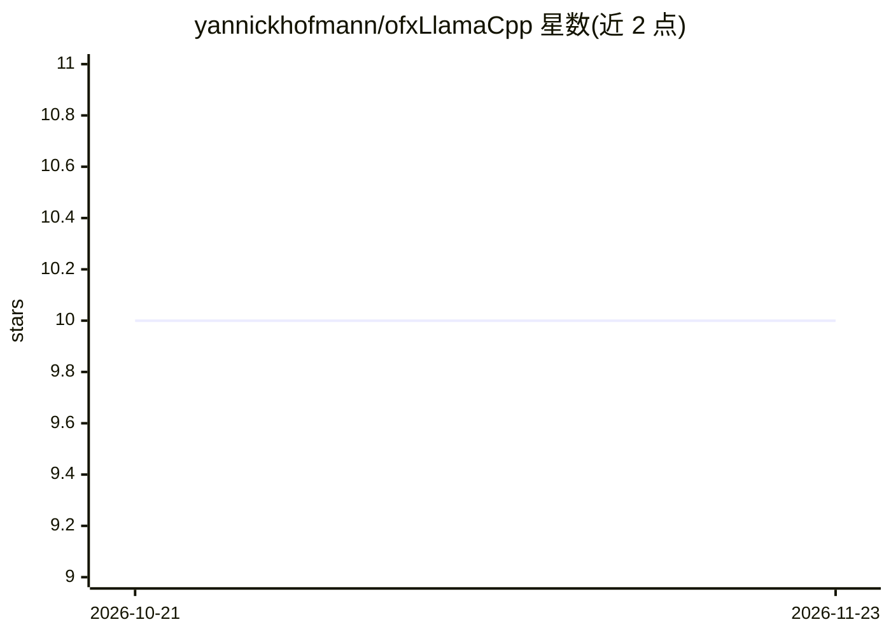

# yannickhofmann/ofxLlamaCpp

⭐ 10 · C++ · NOASSERTION · 推送 2026-05-23 · [GitHub](https://github.com/yannickhofmann/ofxLlamaCpp) · [官网](https://github.com/yannickhofmann/ofxLlamaCpp) · 个人维护

**openFrameworks 插件：在 C++ 中本地运行 LLM 推理**

openFrameworks 生态的 addon，封装 llama.cpp 推理引擎与 minja.hpp 聊天模板渲染，将本地 GGUF 模型推理接入创意编程、交互装置与实时生成应用，无需 Python 或外部依赖。提供 example_basics 与 example_chat 示例，支持 Local（GGUF）与 Remote（OpenAI 兼容 API，如 LiteLLM、Azure OpenAI）两种后端模式。构建依赖 CMake（Windows 用 Project Generator + Visual Studio），已知问题包括大模型 CPU 推理慢与上下文内存带来的延迟。

## 筛选速览

| 维度 | 判定 | 备注 |
|---|---|---|
| AI 角色 | `ai-ecosystem` | LLM/agent 周边工具 |
| 许可风险 | `none` | NOASSERTION |
| 部署形态 | `None` |  |
| 模型依赖 | local-ok | 支持本地模型 |
| 硬件要求 | — | 无带数字的原话,不猜 |
| 安装摩擦 | `low` | 无编译、无系统依赖或容器化 |
| 成熟度 | — | 结构信号不足 |

## 能力要点

- 通过 llama.cpp 在 C++ 中本地运行 GGUF 模型推理
- 支持本地 GGUF 与 OpenAI 兼容远程 API 双后端模式
- 集成 minja.hpp 做 LLM 聊天模板渲染
- 在 Ubuntu/Debian、树莓派 ARM64、Apple Silicon M2、Windows 11 上验证过

## 适用场景

- 在 openFrameworks 创意编程项目中集成 LLM
- 构建无需 Python 的本地实时生成式交互装置
- 示例切换到 OpenAI 兼容网关或 Azure OpenAI 端点

## 场景标签

`推理引擎` · 领域:训练与推理

## 证据(README 行号)

> L3: openFrameworks addon for running LLM inference directly in C++ using llama.cpp.
> L7: ofxLlamaCpp brings large-language-model inference into the openFrameworks ecosystem. It acts as a simple bridge betw
> L15: In addition to local GGUF inference, the examples `example_basics` and `example_chat` can also talk to remote OpenA

## 星数曲线

2026-10-21 10 → 2026-11-23 10（+0）

---
*卡片 v1 · prompt 1.4 · 生成 2026-11-19 · 置信度 high · 依据 README sha `41c8ce9d8e15` · [字段定义](../../DATASET.md)*
