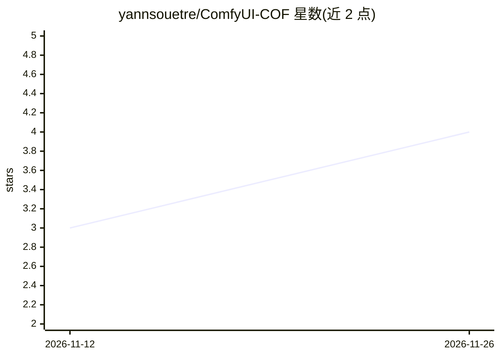

# yannsouetre/ComfyUI-COF

⭐ 4 · Python · MIT · 推送 2026-11-15 · [GitHub](https://github.com/yannsouetre/ComfyUI-COF) · [官网](https://yannsouetre.github.io/cof/) · 个人维护

**在 ComfyUI 中加载 COF 角色文件的自定义节点包**

一组 ComfyUI 自定义节点，读取 COF（Character Open File）格式的 .cof 文件，把其中打包的 AI 角色资料——参考图、服装、姿势、LoRA、RefMods（预编码参考潜变量）、语音、动作片段、性格、记忆（COF 1.1）与心理图谱（COF 1.2）——按所选预设（语言、年龄、风格等）导出为图像、提示词、LoRA、音频与文本文件，供工作流后续节点使用。加载器强制执行角色文件内的权利与年龄规则（含 intimate 内容开关、真实人物同意校验）。无需额外 Python 包，节点提供源码安装。

## 筛选速览

| 维度 | 判定 | 备注 |
|---|---|---|
| AI 角色 | `ai-ecosystem` | LLM/agent 周边工具 |
| 许可风险 | `permissive` | MIT |
| 部署形态 | `None` |  |
| 模型依赖 | — | README 未给出锁定关系 |
| 硬件要求 | — | 无带数字的原话,不猜 |
| 安装摩擦 | `low` | 无编译、无系统依赖或容器化 |
| 成熟度 | — | 结构信号不足 |

## 能力要点

- 一个加载器节点加逐类别的角色节点：外观、LoRA、RefMods、3D、语音、姿势、动作、文件、记忆、心理
- 将 COF 1.2 心理图谱渲染为 soul/lines/prose 三种文本格式，供语言模型或图像/视频生成节点使用
- 强制执行角色权利与年龄规则：intimate 内容需 allow intimate 开关，真实人物裸露内容需同意记录且年满 18
- 无需额外 Python 包

## 适用场景

- 在 ComfyUI 工作流中以一致的角色设定（外观、LoRA、提示词）生成图像
- 为语言模型节点导出角色的性格与心理文本
- 需要在生成流程中执行角色使用权利与年龄限制的团队

## 场景标签

`图像生成` `视频生成` · 领域:内容生成

## 证据(README 行号)

> L11: A **COF (Character Open File)** `.cof` packs a whole AI character — reference views, outfits, places, LoRA, pre-enc
> L13: ## Nodes

## 星数曲线

2026-11-12 3 → 2026-11-26 4（+1）

---
*卡片 v1 · prompt 1.4 · 生成 2026-11-26 · 置信度 mid · 依据 README sha `0e2da6fc1eda` · [字段定义](../../DATASET.md)*
