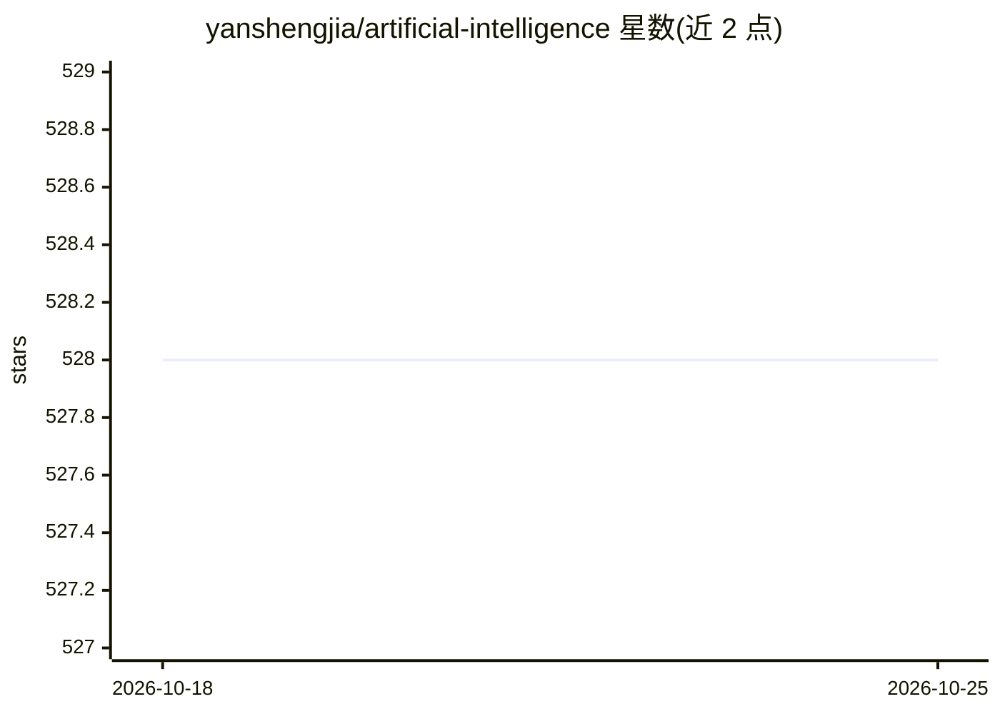

# yanshengjia/artificial-intelligence

⭐ 528 · Jupyter Notebook · Apache-2.0 · 推送 2026-03-28 · [GitHub](https://github.com/yanshengjia/artificial-intelligence) · 个人维护

**AI 教学练习项目集：搜索/遗传算法/神经网络等多类实现**

个人维护的基于项目的 AI 练习场，包含 6 个独立项目：24 Puzzle 与 Million Queens（启发式搜索）、Email Spam Filter、DNN 对抗攻击、求解函数最大值的遗传算法、基于神经网络的人脸识别。项目以 TensorFlow 为主题标签之一，代码形式提供，面向学习经典 AI 算法实现的开发者与学生。README 仅列出项目清单与联系方式，未给出安装运行说明。

## 筛选速览

| 维度 | 判定 | 备注 |
|---|---|---|
| AI 角色 | `ai-knowledge` | 知识聚合/清单类 |
| 许可风险 | `permissive` | Apache-2.0 |
| 部署形态 | `None` |  |
| 模型依赖 | — | README 未给出锁定关系 |
| 硬件要求 | — | 无带数字的原话,不猜 |
| 安装摩擦 | `low` | 无编译、无系统依赖或容器化 |
| 成熟度 | — | 结构信号不足 |

## 能力要点

- 覆盖启发式搜索、遗传算法、神经网络、对抗攻击等多类算法实现
- 包含人脸识别与垃圾邮件过滤两个应用型项目
- TensorFlow 生态标签

## 适用场景

- 学习经典 AI 算法的参考实现
- 课程作业或练习的项目素材

## 场景标签

`教程课程` · 领域:学习与行业

## 证据(README 行号)

> L3: A project-based Artificial Intelligence (AI) playground.
> L5: ## Projects

## 星数曲线

2026-10-18 528 → 2026-10-25 528（+0）

---
*卡片 v1 · prompt 1.4 · 生成 2026-10-21 · 置信度 mid · 依据 README sha `6cd78fbca767` · [字段定义](../../DATASET.md)*
