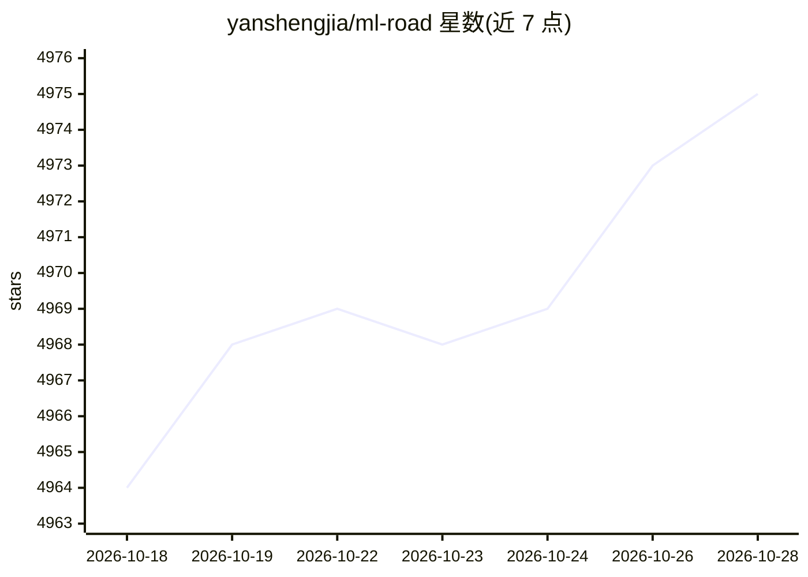

# yanshengjia/ml-road

⭐ 4,975 · Python · MIT · 推送 2026-08-01 · [GitHub](https://github.com/yanshengjia/ml-road) · 个人维护 · 中文 README

**机器学习与 Agentic AI 学习资源清单：课程、书籍与资料汇编**

个人维护的学习资源汇总仓库，分 Courses、Books、Agentic AI 等板块收录机器学习与深度学习课程（Stanford、NTU、NYU、CMU 等校，附 Coursera/Bilibili/YouTube 链接）、经典教材 PDF（含中英文版本，如西瓜书、PRML、Dive into Deep Learning）及 Agentic AI 课程资料，按学科类别标注。声明仅供教育用途、禁止商用，附版权下架联系说明。无安装运行环节，为纯阅读型清单。

## 筛选速览

| 维度 | 判定 | 备注 |
|---|---|---|
| AI 角色 | `ai-knowledge` | 知识聚合/清单类 |
| 许可风险 | `permissive` | MIT |
| 部署形态 | `None` |  |
| 模型依赖 | — | README 未给出锁定关系 |
| 硬件要求 | — | 无带数字的原话,不猜 |
| 安装摩擦 | `low` | 无编译、无系统依赖或容器化 |
| 成熟度 | — | 结构信号不足 |

## 能力要点

- 覆盖 ML/DL/NLP/CV/强化学习等方向的课程表（含讲者与多平台链接）
- 教材 PDF 收录含中文译本（西瓜书、统计学习方法、d2l 等）
- 新增 Agentic AI 板块收录相关课程资源
- 声明仅限教育用途、非商业使用

## 适用场景

- 系统查找机器学习与深度学习入门课程
- 获取经典 ML/NLP 教材的中英文 PDF
- 了解 Agentic AI 方向的入门课程资料

## 场景标签

`精选清单` · 领域:学习与行业

## 证据(README 行号)

> L1: # Machine Learning Road
> L16: ## Courses
> L45: ## Books
> L71: ## Agentic AI

## 星数曲线

2026-10-18 4,964 → 2026-10-28 4,975（+11）

---
*卡片 v1 · prompt 1.4 · 生成 2026-10-20 · 置信度 high · 依据 README sha `dec34390b4ce` · [字段定义](../../DATASET.md)*
