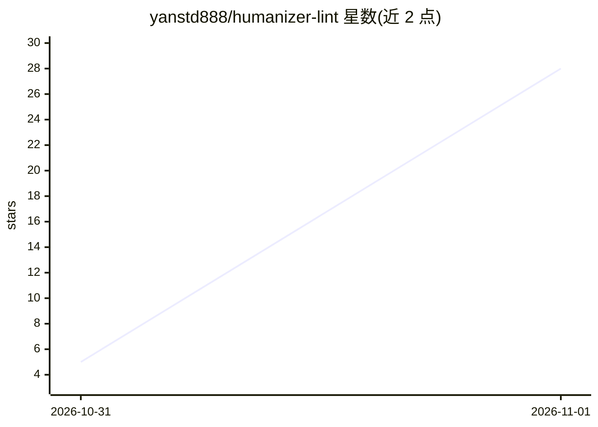

# yanstd888/humanizer-lint

⭐ 28 · JavaScript · MIT · 推送 2026-10-31 · [GitHub](https://github.com/yanstd888/humanizer-lint) · [官网](https://humanizer.aiclub.ai.id/) · 个人维护

**检测 AI 腔调与散文风格的本地确定性 linter（CLI）**

面向写作与 agent 工作流的文本风格检查工具：以确定性规则与句长统计（Burstiness CV、相邻节奏差、自适应 MATTR）检测 LLM 常见措辞、句式节奏单一与结构套话，输出 0-100 分、违规位置、JSON 与标准退出码，不重写原文、不判断作者是否为人类。内置 8 种语言规则包，另以 Intl.Segmenter 通用文体计量覆盖 100+ 语言；支持从 1-5 个样本生成个人声音指纹。零运行时依赖、无网络调用，可经 npm/npx 或 skills CLI 作为 agent 技能安装。

## 筛选速览

| 维度 | 判定 | 备注 |
|---|---|---|
| AI 角色 | `ai-ecosystem` | LLM/agent 周边工具 |
| 许可风险 | `permissive` | MIT |
| 部署形态 | `library` | 以包/库形式分发 |
| 模型依赖 | — | README 未给出锁定关系 |
| 硬件要求 | — | 无带数字的原话,不猜 |
| 安装摩擦 | `low` | 无编译、无系统依赖或容器化 |
| 成熟度 | — | 结构信号不足 |

## 能力要点

- 确定性检测：Burstiness（CV>=0.45）、相邻节奏差、自适应 MATTR 词汇多样性
- 8 个语言规则包（en/id/es/ms/fr/de/pt/zh）+ 100+ 语言通用文体计量
- JSON 输出与标准退出码，可用于 CI/CD 与 agent 闭环工作流
- 个人声音指纹：从最多 5 个写作样本生成并用于比对

## 适用场景

- 给 LLM 生成的文档/博客做去 AI 腔的散文 lint 门禁
- 在 agent 工作流中作为草稿验证步骤（跑 lint、只改被标记处、复检）
- 检查多语言文本的句式节奏与词汇重复问题

## 场景标签

 · 领域:开发工具/写作质量

## 证据(README 行号)

> L26: - Provides mandatory `node <skill_dir>/scripts/analyze.mjs --stdin --json` verification and `npx humanizer-lint` CL
> L59: It works locally with zero runtime dependencies. Instead of rewriting text through another language model, it repor
> L74: For a closed-loop agent workflow, install `npx skills add yanstd888/humanizer-lint`, draft without changing facts, 

## 星数曲线

2026-10-31 5 → 2026-11-01 28（+23）

---
*卡片 v1 · prompt 1.4 · 生成 2026-11-01 · 置信度 high · 依据 README sha `e60c6ad3b984` · [字段定义](../../DATASET.md)*
