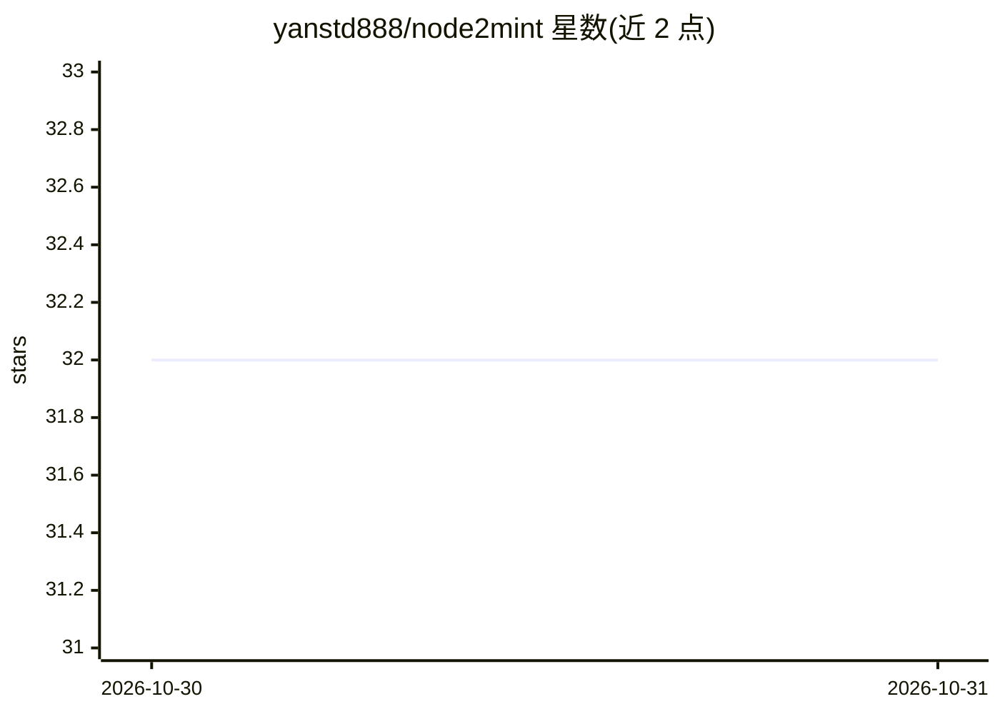

# yanstd888/node2mint

⭐ 32 · TypeScript · MIT · 推送 2026-10-28 · [GitHub](https://github.com/yanstd888/node2mint) · 个人维护

**自托管 AI 市场与 OpenAI 兼容 API 网关：令牌计费+托管交易**

基于 Next.js 15、Go 1.22、PostgreSQL 16、Redis 7 与 Caddy 2 的全栈平台，包含三部分：数字产品市场（托管交易、卖家店铺、退款）、令牌计费引擎（行级锁原子账本、动态令牌计量、Redis 限流）、以及 OpenAI 兼容的 /v1/chat/completions 网关，支持上游供应商（OpenAI、Anthropic、自定义端点）健康检查与熔断故障转移。支付支持 Stripe、DOKU、QRIS/银行转账与 TRC-20 USDT。面向需自建 AI 转售或令牌市场业务的运营者，以 Docker Compose 部署。

## 筛选速览

| 维度 | 判定 | 备注 |
|---|---|---|
| AI 角色 | `ai-ecosystem` | LLM/agent 周边工具 |
| 许可风险 | `permissive` | MIT |
| 部署形态 | `self-host` | docker 或自建部署 |
| 模型依赖 | — | README 未给出锁定关系 |
| 硬件要求 | — | 无带数字的原话,不猜 |
| 安装摩擦 | `low` | 无编译、无系统依赖或容器化 |
| 成熟度 | — | 结构信号不足 |

## 能力要点

- PostgreSQL SELECT FOR UPDATE 行级锁的原子余额账本
- OpenAI 兼容网关，上游多供应商健康检查与熔断故障转移
- 托管交易（escrow）结算与联盟佣金/推荐引擎
- Stripe/DOKU/QRIS 银行转账/TRC-20 USDT 多渠道支付

## 适用场景

- 自建 AI 模型转售服务并按令牌用量计费
- 搭建带托管交易与卖家店铺的数字产品市场
- 为 OpenAI SDK、Cursor、Cline 等客户端提供统一的 API 接入与计费

## 场景标签

`模型网关` · 领域:Agent 开发

## 证据(README 行号)

> L9:  Self-hosted AI marketplace, token billing engine, and OpenAI-compatible API gateway with atomic ledger balances, pr
> L62:  OpenAI-Compatible <code>/v1/chat/completions</code>: Serves upstream models to client apps, SDKs, Cursor, and Clin
> L172: |`POST`|`/v1/chat/completions`|Bearer API Key|OpenAI-compatible chat completions with failover|

## 星数曲线

2026-10-30 32 → 2026-10-31 32（+0）

---
*卡片 v1 · prompt 1.4 · 生成 2026-10-30 · 置信度 high · 依据 README sha `c9d7b3a792d5` · [字段定义](../../DATASET.md)*
