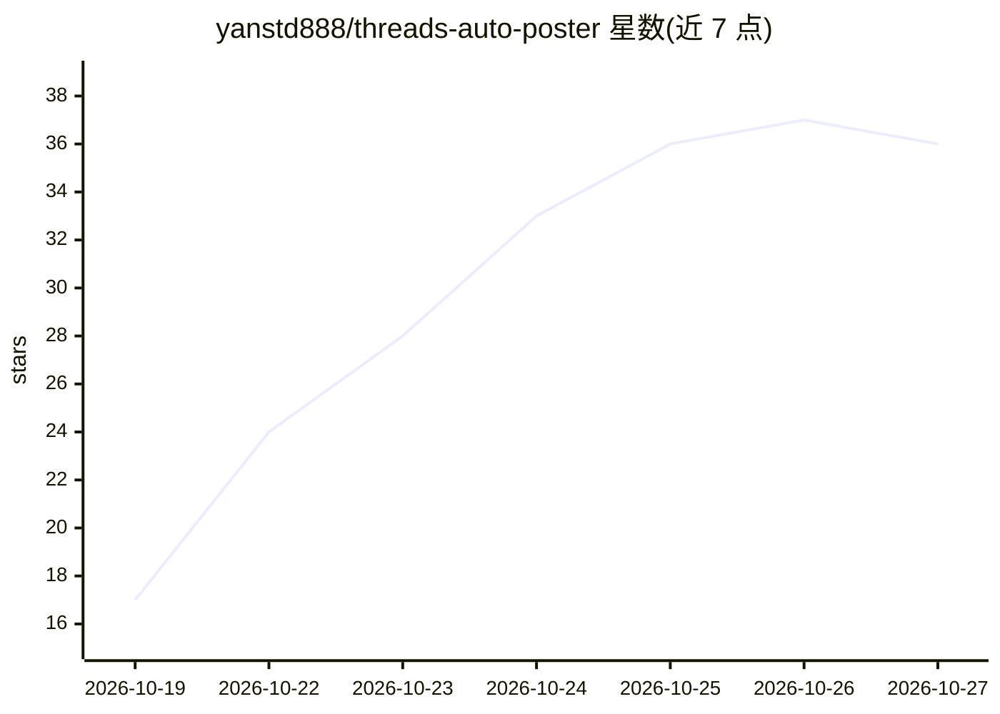

# yanstd888/threads-auto-poster

⭐ 36 · TypeScript · Apache-2.0 · 推送 2026-10-22 · [GitHub](https://github.com/yanstd888/threads-auto-poster) · [官网](https://threads.aiclub.ai.id/) · 个人维护

**自托管 Threads 发帖调度工作台，含可选 AI 起草与人工审批**

面向创作者、营销人员、开发者与小团队的自托管 Threads 内容工作台：统一管理来源注册表、内容支柱、草稿、审批、排程与 OAuth 发布，数据存于本地 SQLite。AI 部分为可选的 Hermes Agent CLI 集成，用于来源感知的内容起草与回复代理，空输出或格式错误会被拒绝；仪表盘、调度与 Threads 连接可在不安装 AI 的情况下运行。安全机制包括默认审批模式、kill switch、HTTPS 来源限制与不自动重试 publish_unknown。提供原生 Node.js 与 Docker Compose 两种部署方式。

## 筛选速览

| 维度 | 判定 | 备注 |
|---|---|---|
| AI 角色 | `ai-enhanced` | 去掉 AI 部分产品仍成立 |
| 许可风险 | `permissive` | Apache-2.0 |
| 部署形态 | `desktop` | 安装包/桌面程序 |
| 模型依赖 | — | README 未给出锁定关系 |
| 硬件要求 | — | 无带数字的原话,不猜 |
| 安装摩擦 | `low` | 无编译、无系统依赖或容器化 |
| 成熟度 | — | 结构信号不足 |

## 能力要点

- Approved HTTPS 来源注册表与来源感知内容准备
- 可选 Hermes Agent CLI 集成做 AI 起草，空/畸形输出被拒绝
- 默认审批模式与 kill switch，回复代理默认关闭
- Threads OAuth 连接与加密令牌存储（SQLite）

## 适用场景

- 在自己的服务器上排程并经人工审批后发布 Threads 帖子
- 维护经审核的来源库并用 AI 生成带来源引用的草稿
- 小团队用私有工作台替代第三方 SaaS 管理发布凭证

## 场景标签

`AI 写作` `工作流自动化` · 领域:效率与自动化

## 证据(README 行号)

> L34: - **AI is optional** — the dashboard, scheduling, sources, backups, and Threads connection can run without the cont
> L98: The content agent is not required for the core product. You can use the source registry, dashboard, scheduling cont
> L102: Threads Auto Poster currently supports **Hermes Agent** as its CLI content-generation runtime. More integrations s

## 星数曲线

2026-10-19 17 → 2026-10-27 36（+19）

---
*卡片 v1 · prompt 1.4 · 生成 2026-10-25 · 置信度 high · 依据 README sha `58b2ec0f4bee` · [字段定义](../../DATASET.md)*
