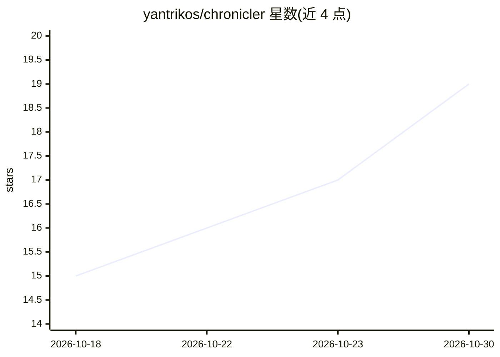

# yantrikos/chronicler

⭐ 19 · TypeScript · MIT · 推送 2026-10-21 · [GitHub](https://github.com/yantrikos/chronicler) · [官网](https://github.com/yantrikos/chronicler) · 组织维护

**自托管 AI 角色扮演客户端：带跨会话持久记忆**

本地优先的开源 AI 角色扮演与角色聊天应用，通过 docker compose 自托管运行。导入社区 v2/v3 角色卡格式，可连接任意 OpenAI 兼容 LLM（Ollama、OpenAI、Anthropic、OpenRouter、llama.cpp、vLLM 等）。核心机制是 YantrikDB 记忆引擎的三级写入契约（reflex/heuristic/canon），记忆带 visible_to ACL 实现群聊隐私过滤，另支持原生 MCP（工具/资源/提示词）与 npm 扩展 SDK。抽取模型建议 7B 以上，低于 7B 时事实归属不可靠。

## 筛选速览

| 维度 | 判定 | 备注 |
|---|---|---|
| AI 角色 | `ai-native` | 本体是模型或模型工具 |
| 许可风险 | `permissive` | MIT |
| 部署形态 | `self-host` | docker 或自建部署 |
| 模型依赖 | local-ok | 支持本地模型 |
| 硬件要求 | `cpu-ok` | |
| 安装摩擦 | `low` | 无编译、无系统依赖或容器化 |
| 成熟度 | — | 结构信号不足 |

## 能力要点

- 三级记忆写入契约（reflex/heuristic/canon），草稿需跨会话反复强化才晋升为 canon
- 每条记忆带 visible_to ACL，群聊中角色检索时无法回忆未被告知的秘密
- 原生 MCP 支持（工具、资源、提示词），并提供 npm 扩展 SDK
- 兼容 v2/v3 角色卡与 character_book 触发语义，辅以语义召回

## 适用场景

- 跑长篇角色扮演战役时希望角色记住数月前的剧情
- 群聊场景下控制角色之间的信息可见性
- 完全本地离线运行角色聊天，不向云端发送数据

## 场景标签

`聊天机器人` · 领域:对话与助手

## 证据(README 行号)

> L9: Chronicler is an open-source, self-hosted **AI roleplay and character-chat app** you run on your own machine with `d
> L11: > The problem with existing RP clients isn't the UI — it's that **memory falls apart after a few sessions**. Chroni

## 星数曲线

2026-10-18 15 → 2026-10-30 19（+4）

---
*卡片 v1 · prompt 1.4 · 生成 2026-10-29 · 置信度 mid · 依据 README sha `9d6d091df765` · [字段定义](../../DATASET.md)*
