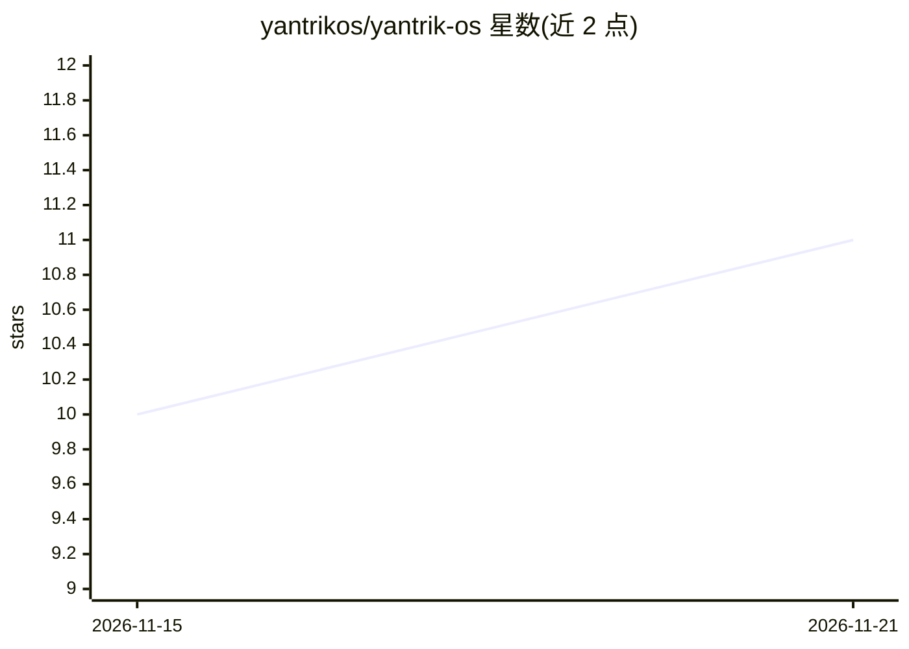

# yantrikos/yantrik-os

⭐ 11 · Rust · GPL-3.0 · 推送 2026-11-20 · [GitHub](https://github.com/yantrikos/yantrik-os) · [官网](https://www.yantrikos.com) · 组织维护

**面向 AI agent 的 Debian Linux 桌面：agent 经类型化接口操作应用**

基于 Debian 的 Linux 桌面环境，以 nightly live ISO 形式发布。每个应用通过 unix socket 发布 describe/act 两个调用，agent（Mind）经 harness 协议接入桌面，通过 yos 命令行或 yos-mcp（MCP 接口）操作应用而非猜测截图。权限门把动作分为 safe/standard/sensitive/dangerous 四级，敏感动作弹出审批卡片，支持 plan/ask/auto/bypass 四种模式。内置 Mind 的记忆存为本机 SQLite 格式的 YantrikDB。镜像不附带模型，需在首次运行时选择云服务商或本机/局域网 Ollama、llama.cpp。

## 筛选速览

| 维度 | 判定 | 备注 |
|---|---|---|
| AI 角色 | `ai-native` | 本体是模型或模型工具 |
| 许可风险 | `viral` | GPL-3.0 |
| 部署形态 | `None` |  |
| 模型依赖 | local-ok | 支持本地模型 |
| 硬件要求 | — | 无带数字的原话,不猜 |
| 安装摩擦 | `low` | 无编译、无系统依赖或容器化 |
| 成熟度 | `idea` | |

## 能力要点

- app.describe/app.act 类型化控制面，yos 命令行与 yos-mcp 提供 MCP 接入
- 四级动作分级与 plan/ask/auto/bypass 权限模式，敏感操作弹出审批卡片
- Mind 经 harness 协议接入，内置 Yantrik Mind、Hermes、Pi、OpenClaw、DeepSeek 源码
- YantrikDB 记忆以本机 SQLite 存储，可读取、导出或删除

## 适用场景

- 在桌面环境中让 AI agent 代为打开和操作应用
- 对 agent 可执行的操作范围和审批方式进行精细控制
- 在本地以 SQLite 形式保存和查看 agent 的记忆

## 场景标签

`AI 助手` · 领域:对话与助手

## 证据(README 行号)

> L8: **A Debian-based Linux desktop built so AI agents can work on it beside you, safely.** Every app
> L164: - **Minds.** A Mind is any agent that attaches to the desktop through the
> L90: > **You need a model for the AI parts to be useful, and the image ships none.**

## 星数曲线

2026-11-15 10 → 2026-11-21 11（+1）

---
*卡片 v1 · prompt 1.4 · 生成 2026-11-19 · 置信度 mid · 依据 README sha `42ed3a32a357` · [字段定义](../../DATASET.md)*
