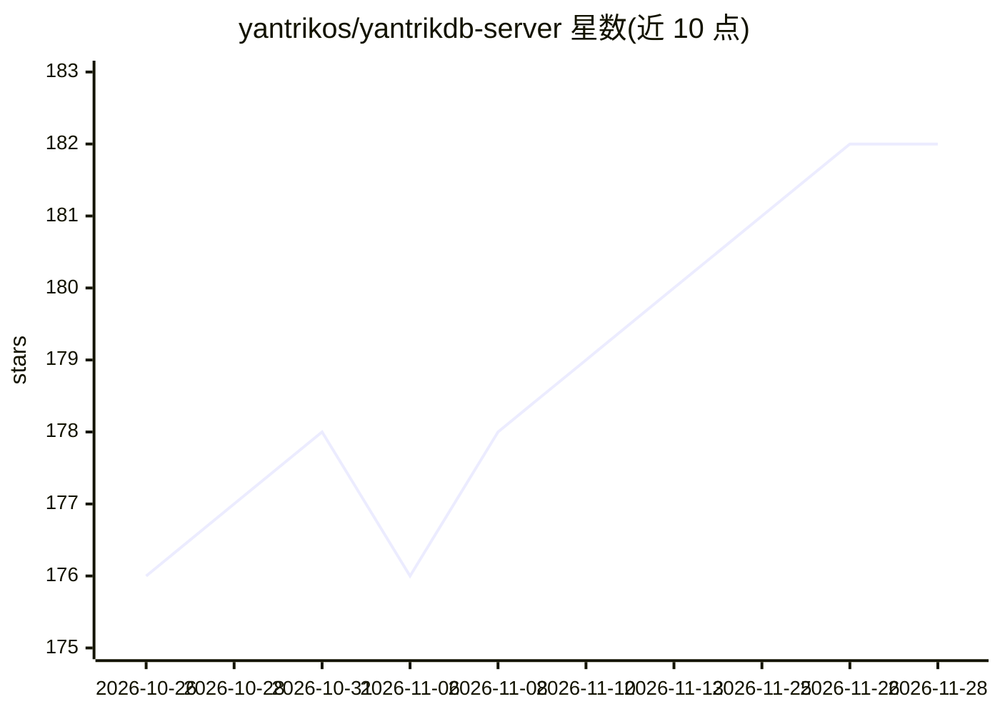

# yantrikos/yantrikdb-server

⭐ 182 · Rust · Apache-2.0 · 推送 2026-11-22 · [GitHub](https://github.com/yantrikos/yantrikdb-server) · [官网](https://yantrikdb.com) · 个人维护

**为 AI agent 提供记忆管理的认知记忆数据库**

以 Rust 编写的记忆数据库，面向 AI agent 的持久化记忆场景：通过时间衰减实现遗忘、合并重复记忆、检测矛盾声明，并提供实体关系图、多信号评分与主动触发。以三种形态提供：Python/Rust 嵌入式库、MCP server（含 15 个记忆工具）、HTTP 二进制 API 与 HA 集群。README 记录了基准数据的更正声明与已知限制（矛盾检测的作用域约束），当前版本为 v0.20.0。

## 筛选速览

| 维度 | 判定 | 备注 |
|---|---|---|
| AI 角色 | `ai-ecosystem` | LLM/agent 周边工具 |
| 许可风险 | `permissive` | Apache-2.0 |
| 部署形态 | `self-host` | docker 或自建部署 |
| 模型依赖 | — | README 未给出锁定关系 |
| 硬件要求 | — | 无带数字的原话,不猜 |
| 安装摩擦 | `low` | 无编译、无系统依赖或容器化 |
| 成熟度 | — | 结构信号不足 |

## 能力要点

- 时间衰减半衰期、记忆合并与矛盾检测三项认知操作
- MCP server 提供 15 个工具（remember/recall/think/graph 等）
- Rust 单二进制 HTTP 服务，支持 2-voter+1-witness HA 集群
- README 公开基准更正记录与未修复的读写性能问题

## 适用场景

- 为长期运行的 agent 提供持久记忆并自动召回
- 合并 agent 会话中产生的重复记忆片段
- 检测 agent 记忆中相互矛盾的声明
- 多机/多租户部署共享 agent 记忆集群

## 场景标签

`Agent 记忆` · 领域:Agent 开发

## 证据(README 行号)

> L15: YantrikDB is different. It's a **cognitive memory engine** — embed it, run it as a server, or connect via MCP. It t
> L107: ## Get started in 60 seconds — Claude Code / Cursor / Windsurf
> L169: Single Rust binary. HTTP + binary wire protocol. 2-voter + 1-witness HA cluster via Docker Compose or Kubernetes. 

## 星数曲线

2026-10-26 176 → 2026-11-28 182（+6）

---
*卡片 v1 · prompt 1.4 · 生成 2026-11-26 · 置信度 high · 依据 README sha `facbcac229d9` · [字段定义](../../DATASET.md)*
