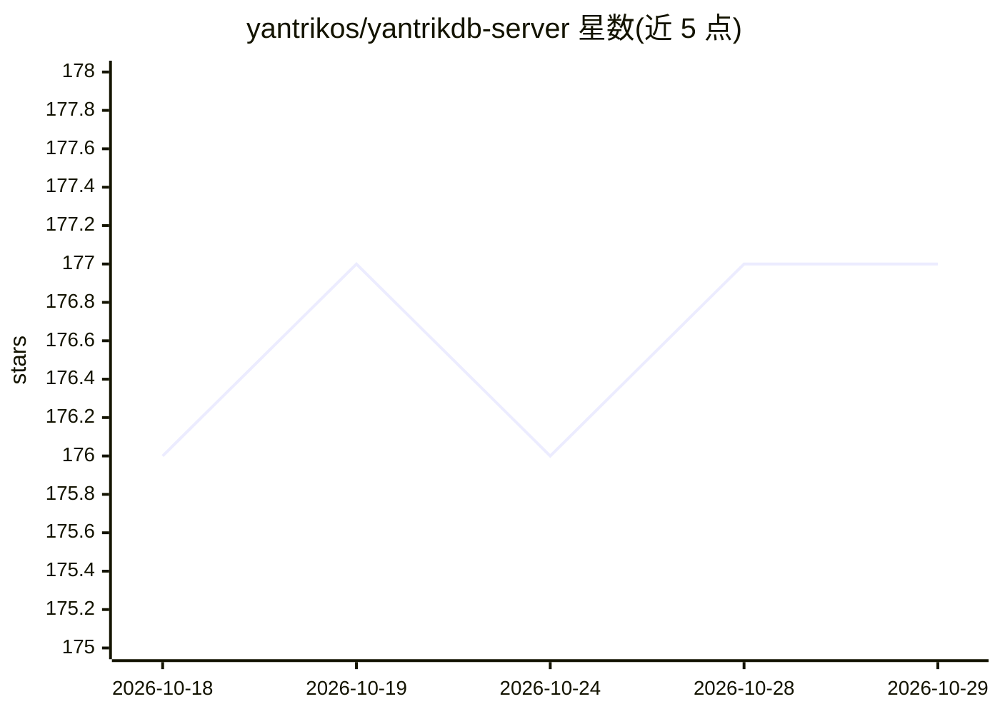

# yantrikos/yantrikdb-server

⭐ 177 · Rust · Apache-2.0 · 推送 2026-10-28 · [GitHub](https://github.com/yantrikos/yantrikdb-server) · [官网](https://yantrikdb.com) · 组织维护

**面向 AI agent 的认知记忆数据库：遗忘、合并、矛盾检测**

Rust 编写的记忆数据库，以 Python/Rust 嵌入库、单二进制 HTTP 服务器（含 2+1 HA 集群）和 MCP server 三种形态提供。核心机制：带可配置半衰期的时间衰减遗忘、think() 合并相似记忆、基于实体关系的矛盾检测（按 subject 键控，系词属性声明默认关闭）、多信号评分（时近×重要性×相似度×图邻近）、实体关系图与主动性触发。本地路径用 SQLite 文件。README 披露性能基准修正与尚未解决的读写竞争问题，矛盾检测范围有限（issue #95 跟踪）。

## 筛选速览

| 维度 | 判定 | 备注 |
|---|---|---|
| AI 角色 | `ai-ecosystem` | LLM/agent 周边工具 |
| 许可风险 | `permissive` | Apache-2.0 |
| 部署形态 | `self-host` | docker 或自建部署 |
| 模型依赖 | — | README 未给出锁定关系 |
| 硬件要求 | — | 无带数字的原话,不猜 |
| 安装摩擦 | `low` | 无编译、无系统依赖或容器化 |
| 成熟度 | — | 结构信号不足 |

## 能力要点

- 时间衰减遗忘与 think() 记忆合并、矛盾检测
- MCP server 提供 15 个记忆工具，接入 Claude Code/Cursor/Windsurf
- 三种形态：pip/cargo 嵌入库、单二进制 HTTP 服务器、Docker 集群
- 多信号评分与实体关系图，本地 SQLite 存储

## 适用场景

- 给我的编码 agent 加跨会话持久记忆，自动召回与记录决策
- 多机/团队共享同一份 agent 记忆集群
- 检测 agent 记忆中随时间出现的矛盾陈述

## 场景标签

`Agent 记忆` · 领域:Agent 开发

## 证据(README 行号)

> L11: **A memory database that forgets, consolidates, and detects contradictions.**
> L15: YantrikDB is different. It's a **cognitive memory engine** — embed it, run it as a server, or connect via MCP. It t
> L99: Full cognitive architecture lives in the standalone engine repo. This server repo focuses on deployment, HTTP API, 

## 星数曲线

2026-10-18 176 → 2026-10-29 177（+1）

---
*卡片 v1 · prompt 1.4 · 生成 2026-10-22 · 置信度 high · 依据 README sha `2df130a44304` · [字段定义](../../DATASET.md)*
