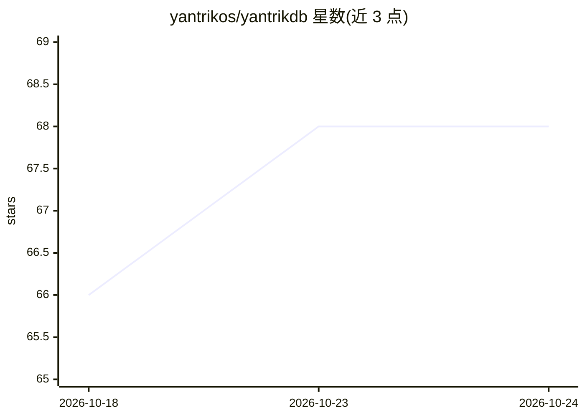

# yantrikos/yantrikdb

⭐ 68 · Rust · Apache-2.0 · 推送 2026-10-16 · [GitHub](https://github.com/yantrikos/yantrikdb) · [官网](https://yantrikdb.com) · 组织维护

**给 AI agent 的认知记忆引擎：时间衰减、矛盾检测、知识图谱与 ANN 召回**

面向需要持久记忆的 AI agent 的嵌入式记忆引擎：以 Rust 库（带 Python 绑定）形式提供，单文件存储，内置 HNSW 向量索引、知识图谱索引、时间索引、重要性衰减堆与键值存储五类索引，支持自主整合、矛盾检测与实体扩展召回。默认捆绑 potion 嵌入模型（可换装 512 维模型或 MiniLM），无需 sentence-transformers 或 ONNX 运行时。配套 yantrikdb-server 提供 HTTP API、MCP 接入与基于 openraft 的多节点集群；限制：存储维度创建后固定，跨进程重复打开同一 SQLite 文件会被检测并拒绝写入。

## 筛选速览

| 维度 | 判定 | 备注 |
|---|---|---|
| AI 角色 | `ai-ecosystem` | LLM/agent 周边工具 |
| 许可风险 | `permissive` | Apache-2.0 |
| 部署形态 | `self-host` | docker 或自建部署 |
| 模型依赖 | — | README 未给出锁定关系 |
| 硬件要求 | — | 无带数字的原话,不猜 |
| 安装摩擦 | `low` | 无编译、无系统依赖或容器化 |
| 成熟度 | — | 结构信号不足 |

## 能力要点

- 五类索引：HNSW 向量、知识图谱、时间、衰减堆、键值
- 矛盾检测与自主整合，agent 经 MCP 自动记忆与召回上下文
- 两级 LSM 解耦写路径，后台任务不阻塞读写
- 内置嵌入模型离线可用，可选 256/384/512 维模型

## 适用场景

- 为 Claude/Cursor 等 MCP 客户端的 agent 提供持久记忆
- 在 Python 或 Rust 项目中嵌入带时间衰减与矛盾检测的记忆层
- 多节点部署时通过 openraft 集群获得跨节点读己之写

## 场景标签

`Agent 记忆` · 领域:Agent 开发

## 证据(README 行号)

> L8: YantrikDB is the engine that manages memories instead of just storing them —
> L18: Want a server instead of a library? yantrikdb-server wraps this engine with an HTTP API, a live demo, and multi-nod
> L224: - **Embedded, not client-server** — single file, no server process (like SQLite)

## 星数曲线

2026-10-18 66 → 2026-10-24 68（+2）

---
*卡片 v1 · prompt 1.4 · 生成 2026-10-24 · 置信度 mid · 依据 README sha `74fdabfd7345` · [字段定义](../../DATASET.md)*
