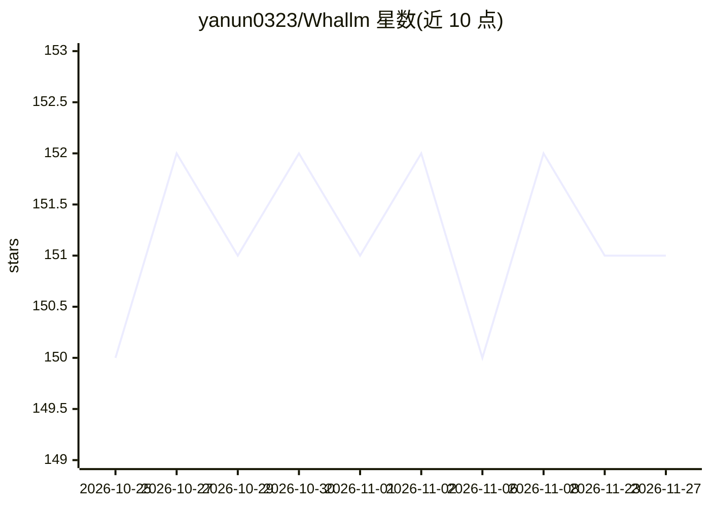

# yanun0323/Whallm

⭐ 151 · Python · MIT · 推送 2026-10-28 · [GitHub](https://github.com/yanun0323/Whallm) · 个人维护 · 中文 README

**在 Apple Silicon Mac 上以 SSD 流式读取专家权重，运行超内存大模型**

Whallm 是 macOS 上的本地大模型推理应用：将常用权重驻留内存、按需从 SSD 读取专家权重，从而在内存小于模型总量的 Apple Silicon Mac 上运行模型。内置聊天界面与 OpenAI 兼容 API（默认端口 11434），README 给出 Codex 客户端的接入配置示例。限制包括：一次仅加载一个模型、一次处理一个请求，MiMo 为预览版，工具调用由客户端执行。以 GitHub Releases 的 zip 安装包分发，MIT 许可，与 DeepSeek/Qwen 无关联。

## 筛选速览

| 维度 | 判定 | 备注 |
|---|---|---|
| AI 角色 | `ai-native` | 本体是模型或模型工具 |
| 许可风险 | `permissive` | MIT |
| 部署形态 | `desktop` | 安装包/桌面程序 |
| 模型依赖 | locked-api |  |
| 硬件要求 | — | 无带数字的原话,不猜 |
| 安装摩擦 | `low` | 无编译、无系统依赖或容器化 |
| 成熟度 | — | 结构信号不足 |

## 能力要点

- 常用权重驻留内存、专家权重从 SSD 按需读取的推理机制
- 内置 OpenAI 兼容 API 服务器（127.0.0.1:11434）与聊天界面
- 支持文本、图像输入的多个模型，MiMo 预览版支持短 WAV 音频
- 应用内 Throughput 功能可自测吞吐

## 适用场景

- 在内存有限的 M 系列 MacBook 上本地运行超大参数模型
- 通过 OpenAI 兼容 API 将本地模型接入 Codex 等客户端
- 本地隐私推理，推理过程不出本机

## 场景标签

`推理引擎` `聊天机器人` · 领域:对话与助手

## 证据(README 行号)

> L11: Whallm runs language models larger than your Mac’s memory on Apple Silicon. It keeps common weights in memory and r
> L23: |Swift1.5 Qwen3.8|Text, images|~119 GiB|
> L33: 1. Download `Whallm-macOS-arm64.zip` from GitHub Releases, unzip it and open `Whallm.app`.

## 星数曲线

2026-10-25 150 → 2026-11-27 151（+1）

---
*卡片 v1 · prompt 1.4 · 生成 2026-11-27 · 置信度 high · 依据 README sha `37b87cc3b3e2` · [字段定义](../../DATASET.md)*
