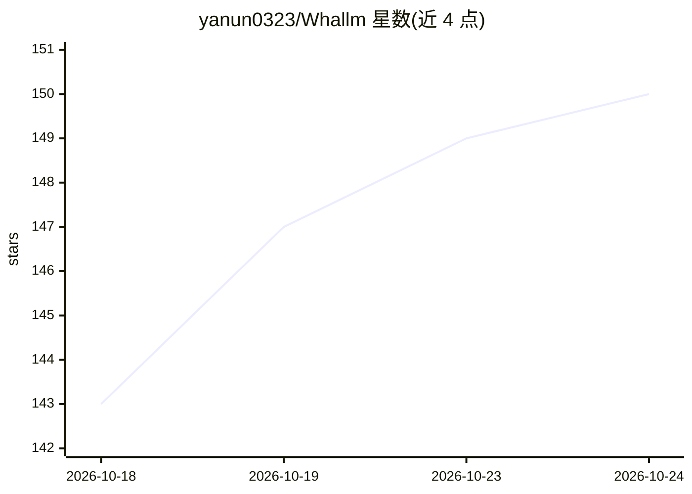

# yanun0323/Whallm

⭐ 150 · Python · MIT · 推送 2026-10-24 · [GitHub](https://github.com/yanun0323/Whallm) · 个人维护 · 中文 README

**在 Apple Silicon Mac 上本地运行超大 MoE 模型的推理应用**

面向 Apple Silicon Mac 的本地 LLM 运行应用：通过专家缓存与 SSD 按需流式读取，使显存有限的 Mac 运行远超内存容量的模型（如 DeepSeek V4/V4.1、Qwen3.8、Swift1.5、MiMo 预览）。自带聊天窗口和 OpenAI 兼容 API（默认 127.0.0.1:11434），引擎以 C++ 和 Metal 编写。要求 macOS 15+、64 GiB 内存推荐、快速内置/雷雳/USB4 SSD；单模型加载、单请求串行处理，DeepSeek V4.1 模型文件约 458 GiB。

## 筛选速览

| 维度 | 判定 | 备注 |
|---|---|---|
| AI 角色 | `ai-ecosystem` | LLM/agent 周边工具 |
| 许可风险 | `permissive` | MIT |
| 部署形态 | `desktop` | 安装包/桌面程序 |
| 模型依赖 | — | README 未给出锁定关系 |
| 硬件要求 | — | 无带数字的原话,不猜 |
| 安装摩擦 | `low` | 无编译、无系统依赖或容器化 |
| 成熟度 | — | 结构信号不足 |

## 能力要点

- 专家缓存 + SSD 按需读取，运行超过内存容量的 MoE 模型
- 自带聊天窗口与 OpenAI 兼容 API 服务器
- 自研 C++/Metal Native 引擎，支持 MTP/DSpark 投机解码、图像输入（PNG/JPEG/WebP）
- 提供 M2 Max / M5 Pro 的 prefill/decode 与峰值内存基准数据

## 适用场景

- 在 MacBook 上本地运行 DeepSeek V4.1、Qwen3.8 等超大模型聊天
- 把 Whallm 当本地推理服务端，接入 OpenAI 兼容的 API 客户端
- 内存不足以装下整个模型时，用 SSD 流式读取继续本地推理

## 场景标签

`推理引擎` `聊天机器人` · 领域:对话与助手

## 证据(README 行号)

> L11: Whallm runs large language models on your Apple Silicon Mac. These models are split into many small parts called ex
> L34: 3. Open **Server** and select **Start Server**.

## 星数曲线

2026-10-18 143 → 2026-10-24 150（+7）

---
*卡片 v1 · prompt 1.4 · 生成 2026-10-23 · 置信度 high · 依据 README sha `3083d1cecb96` · [字段定义](../../DATASET.md)*
