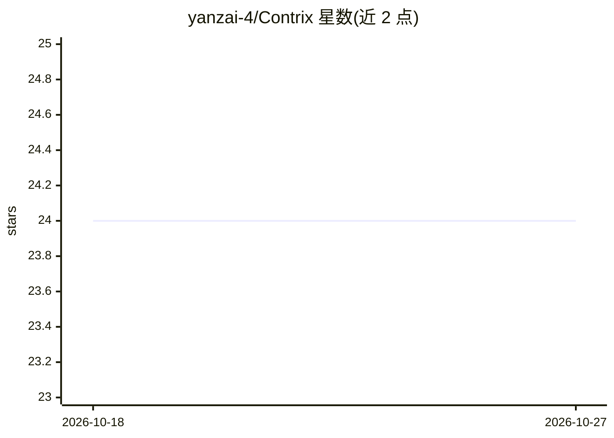

# yanzai-4/Contrix

⭐ 24 · TypeScript · Apache-2.0 · 推送 2026-04-07 · [GitHub](https://github.com/yanzai-4/Contrix) · 个人维护

**把 LLM 调用变成经契约校验的本地 JSON API 的工作流**

面向 AI 工程师与后端/全栈团队的契约优先本地 LLM 集成层：通过 GUI 定义端点契约（输入/输出 schema、字段级要求、共享指令），自动生成 spec 驱动提示词，在同一契约下并排比较提示词/模型/提供商，运行时校验返回 JSON 的格式、必填字段与类型，失败时执行修复/重试/超时/回退流程，并记录 token、延迟与尝试次数。提供本地运行时端点、多语言代码示例与可复制的 vibe-coding 提示词。支持提供商原生结构化输出但声明不止是包装。需 Node.js 20.19+ 与 pnpm 10+，从源码克隆构建运行，Web UI 运行于 localhost:4400，另有静默运行时模式。Apache-2.0 许可。

## 筛选速览

| 维度 | 判定 | 备注 |
|---|---|---|
| AI 角色 | `ai-ecosystem` | LLM/agent 周边工具 |
| 许可风险 | `permissive` | Apache-2.0 |
| 部署形态 | `library` | 以包/库形式分发 |
| 模型依赖 | — | README 未给出锁定关系 |
| 硬件要求 | — | 无带数字的原话,不猜 |
| 安装摩擦 | `low` | 无编译、无系统依赖或容器化 |
| 成熟度 | — | 结构信号不足 |

## 能力要点

- GUI 定义端点契约并自动生成 spec 驱动提示词
- 同一契约下并排比较提示词/模型/提供商
- JSON 校验 + 修复/重试/超时/回退恢复流程
- 生成多语言集成示例与可复制 vibe-coding 提示词

## 适用场景

- 把脆弱的信息抽取提示词变成稳定可调用的本地端点
- 上线前在统一契约下比较不同提示词和模型的表现
- 为结构化输出端点增加校验、恢复和可观测性

## 场景标签

`提示工程` `工作流自动化` · 领域:Agent 开发

## 证据(README 行号)

> L24: Contrix is a contract-first local control layer for LLM integration. You define endpoint contracts with schemas, fi
> L55: Contrix adds a contract, comparison, validation, and integration layer between your app and model APIs.

## 星数曲线

2026-10-18 24 → 2026-10-27 24（+0）

---
*卡片 v1 · prompt 1.4 · 生成 2026-10-27 · 置信度 mid · 依据 README sha `aa4d5821053d` · [字段定义](../../DATASET.md)*
