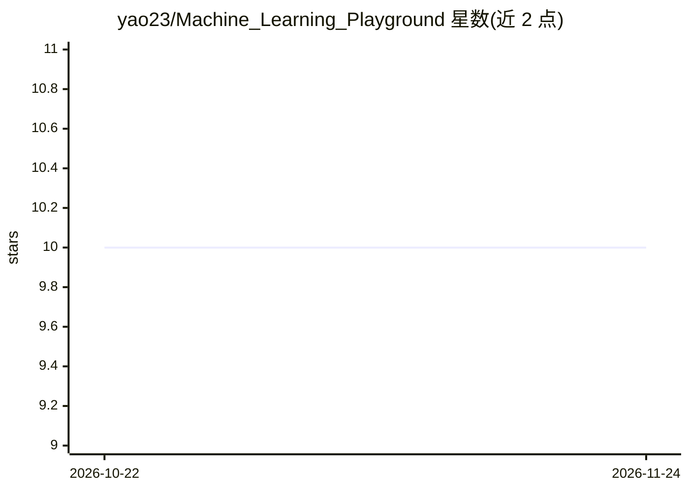

# yao23/Machine_Learning_Playground

⭐ 10 · Python · 推送 2026-02-22 · [GitHub](https://github.com/yao23/Machine_Learning_Playground) · 个人维护

**机器学习练习与课程作业的代码试验场**

存放机器学习在线课程练习、竞赛与个人侧项目的 Playground 仓库。README 仅两行，未说明具体内容结构、运行方式或依赖；主题标签显示涉及 Python、pandas、sklearn、tensorflow。面向学习者本人整理练习代码，具体模块构成与安装运行步骤 README 未提供。

## 筛选速览

| 维度 | 判定 | 备注 |
|---|---|---|
| AI 角色 | `ai-knowledge` | 知识聚合/清单类 |
| 许可风险 | `none` | — |
| 部署形态 | `None` |  |
| 模型依赖 | — | README 未给出锁定关系 |
| 硬件要求 | — | 无带数字的原话,不猜 |
| 安装摩擦 | `low` | 无编译、无系统依赖或容器化 |
| 成熟度 | — | 结构信号不足 |

## 能力要点

- 覆盖在线课程练习、竞赛与侧项目
- 主题标签涉及 pandas/sklearn/tensorflow

## 适用场景

- 查找机器学习课程的练习代码示例
- 参考竞赛与侧项目的实现

## 场景标签

 · 领域:机器学习/学习资源

## 证据(README 行号)

> L2: Playground for Machine Learning (online courses exercise, competiton and side projects)

## 星数曲线

2026-10-22 10 → 2026-11-24 10（+0）

---
*卡片 v1 · prompt 1.4 · 生成 2026-11-19 · 置信度 low · 依据 README sha `76cab1f470ce` · [字段定义](../../DATASET.md)*
