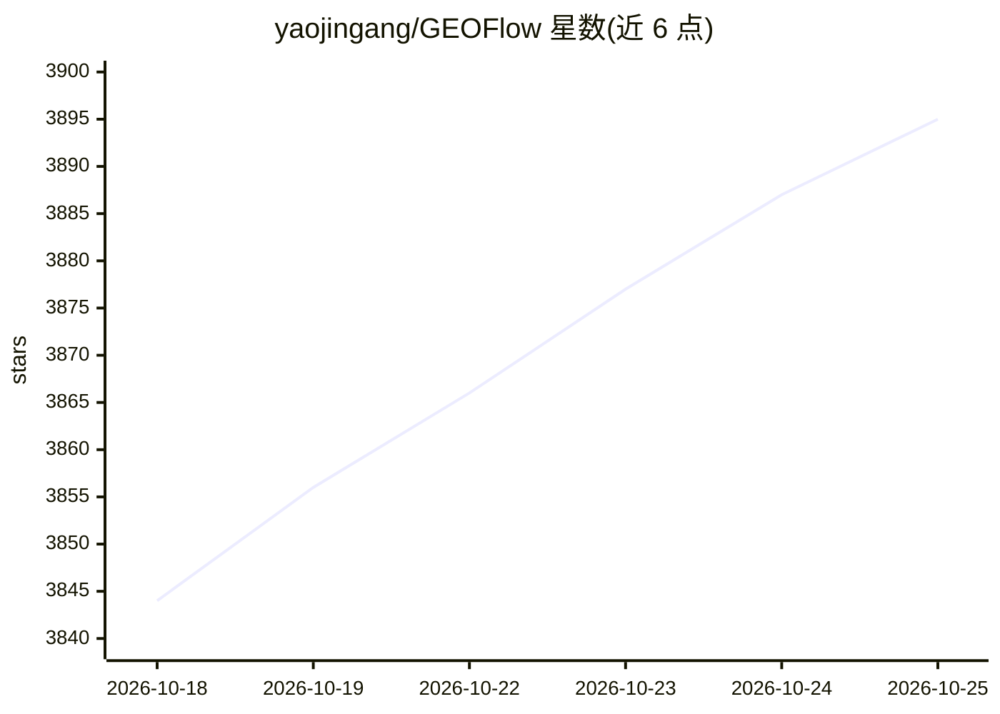

# yaojingang/GEOFlow

⭐ 3,895 · PHP · AGPL-3.0 · 推送 2026-10-25 · [GitHub](https://github.com/yaojingang/GEOFlow) · [官网](https://www.geoflow.me) · 个人维护 · 中文 README

**面向企业官网 GEO 运营的开源内容工程与多站点分发平台**

基于 Laravel 的内容运营系统：集中管理知识库、素材与 AI 模型，进行 AI 内容生产与质量门禁（按知识证据、数据引文、广告规则检查并留审计记录），人工审核后分发到托管站点、GEOFlow Agent 目标站点、WordPress REST 或通用 HTTP API。含 Chrome 运营助手辅助人工发布、独立 Updater 签名更新、CLI、API v1 与内置 Agent Skill。当前源码为 3.2.0-beta.2 预览版，生产部署建议使用正式 Release。采用 AGPL-3.0（历史版本 Apache-2.0），另提供商业授权申请通道。

## 筛选速览

| 维度 | 判定 | 备注 |
|---|---|---|
| AI 角色 | `ai-enhanced` | 去掉 AI 部分产品仍成立 |
| 许可风险 | `dual` | AGPL-3.0 |
| 部署形态 | `self-host` | docker 或自建部署 |
| 模型依赖 | — | README 未给出锁定关系 |
| 硬件要求 | — | 无带数字的原话,不猜 |
| 安装摩擦 | `low` | 无编译、无系统依赖或容器化 |
| 成熟度 | `idea` | |

## 能力要点

- 知识库支持结构化切片、语义规划、向量召回与稳定回退
- AI 质检门禁记录评分、原文定位、法规依据与人工放行审计
- 托管站点、Agent 目标站点、WordPress REST 与通用 HTTP API 多渠道分发
- 独立 Updater 提供签名更新、完整备份与恢复点回滚

## 适用场景

- 企业团队围绕品牌知识持续运营官网 GEO 内容并留存审核链路
- 从一套后台管理多个品牌站点或 GEO 子频道
- 通过 Chrome 运营助手结合人工确认完成外部渠道发布

## 场景标签

`RAG` `AI 写作` `工作流自动化` · 领域:效率与自动化

## 证据(README 行号)

> L36:     A[可信知识与素材] --> B[AI 内容生产]
> L37:     B --> C[AI 质检门禁]
> L60: |可信知识与内容生产|集中管理知识库、标题库、关键词库、图片库、作者、提示词和 AI 模型；知识库支持结构化切片、可选语义规划、向量召回和稳定回退|

## 星数曲线

2026-10-18 3,844 → 2026-10-25 3,895（+51）

---
*卡片 v1 · prompt 1.4 · 生成 2026-10-20 · 置信度 mid · 依据 README sha `022ef7ac2904` · [字段定义](../../DATASET.md)*
