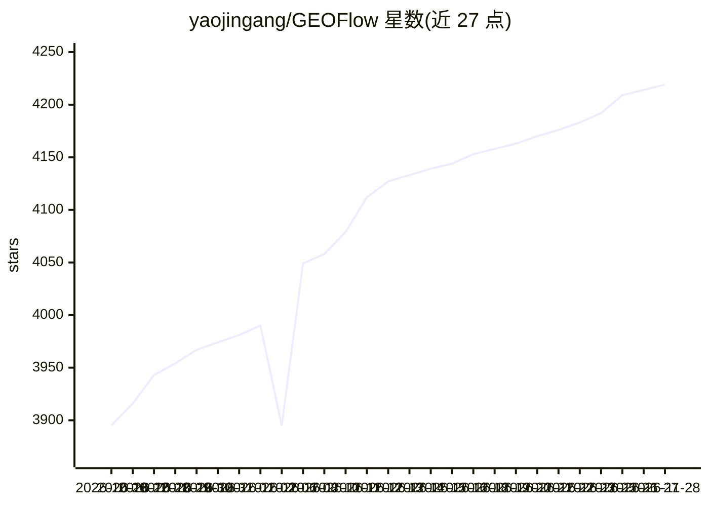

# yaojingang/GEOFlow

⭐ 4,219 · PHP · AGPL-3.0 · 推送 2026-11-13 · [GitHub](https://github.com/yaojingang/GEOFlow) · [官网](https://www.geoflow.me) · 个人维护 · 中文 README

**面向企业内容团队的 GEO 内容生产与多站点分发平台**

GEOFlow 将企业知识导入、AI 文章与专题生产、智能配图、AI 质量门禁、人工审核、多站点分发和 AI 可见性分析串联为一条运营链路。团队可在同一后台管理资料来源、内容版本与发布结果，支持 TXT/Markdown/DOCX/PDF/PPTX 知识导入、向量检索、签名更新与回滚。技术栈为 Laravel + PostgreSQL(pgvector) + Redis，通过 Docker Compose 部署，另提供 CLI、Chrome 运营助手与 Agent Skill。采用 AGPL-3.0，闭源集成需另行商业授权。

## 筛选速览

| 维度 | 判定 | 备注 |
|---|---|---|
| AI 角色 | `ai-native` | 本体是模型或模型工具 |
| 许可风险 | `dual` | AGPL-3.0 |
| 部署形态 | `self-host` | docker 或自建部署 |
| 模型依赖 | — | README 未给出锁定关系 |
| 硬件要求 | — | 无带数字的原话,不猜 |
| 安装摩擦 | `low` | 无编译、无系统依赖或容器化 |
| 成熟度 | — | 结构信号不足 |

## 能力要点

- 知识导入支持 TXT/Markdown/DOCX/PDF/PPTX，带向量检索与智能配图
- AI 质量门禁按知识证据、引文、广告规则检查文章并记录评分与修改建议
- 多站点交付支持托管站点、WordPress REST、通用 HTTP API 与自动生成 sitemap/llms.txt
- 独立 Updater 提供签名更新、完整备份与恢复点回滚

## 适用场景

- 围绕产品与行业知识持续运营企业官网 GEO 内容
- 从一套后台管理多品牌、多站点的栏目与发布
- 以 AI 质检加人工审核把关内容质量后分发
- 建设行业信源站并输出 sitemap 与 llms.txt

## 场景标签

`RAG` `AI 写作` · 领域:内容生成

## 证据(README 行号)

> L15: GEOFlow 把企业知识导入、AI 文章与专题生产、智能配图、质量门禁、人工审核、多站点分发和 AI 可见性分析接进一条运营链路。品牌、增长和内容团队可以用它建设企业官网、GEO 子频道、行业信源站或内部内容运营平台，在同一套后
> L61: |AI 质量门禁|按知识证据、数据与引文、广告规则和发布语境检查文章，记录评分、原文定位、修改建议及历史结果；支持自动优化、按分数放行和人工审核|
> L93: |企业官网 GEO 运营|围绕产品、案例、FAQ、行业知识和品牌规则持续建设内容|企业知识库、任务、质检、官网发布、数据分析|

## 星数曲线

2026-10-26 3,895 → 2026-11-28 4,219（+324）

---
*卡片 v1 · prompt 1.4 · 生成 2026-11-23 · 置信度 high · 依据 README sha `2b2dbe3585db` · [字段定义](../../DATASET.md)*
