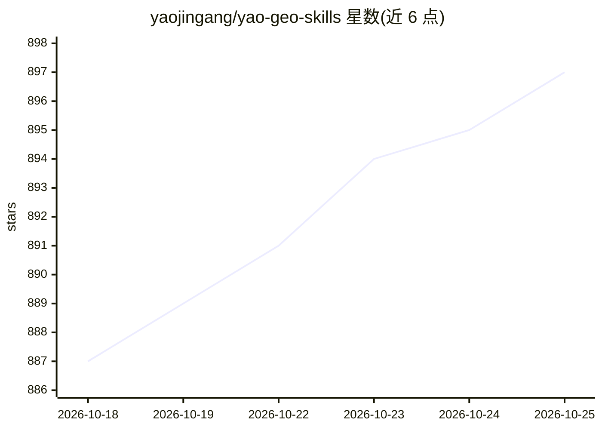

# yaojingang/yao-geo-skills

⭐ 897 · HTML · MIT · 推送 2026-10-01 · [GitHub](https://github.com/yaojingang/yao-geo-skills) · [官网](https://yaojingang.github.io/yao-geo-skills/) · 个人维护 · 中文 README

**GEO（生成式引擎优化）工作流的 Agent Skill 集合仓库**

面向 GEO（Generative Engine Optimization）运营的开源 Skill 包仓库，收录 24 个 skill，按运营、战略诊断、页面技术、内容生产、知识资产、监测归因和研究拓词七类组织。每个 skill 含 SKILL.md 调用入口、manifest.json 元信息、模板、evals 触发与产物校验及人读说明页，并附 python3 scripts/validate_repository.py 仓库级结构校验脚本。通过 git clone 或 sparse checkout 下载，面向需要复用和沉淀 GEO 方法的运营与内容团队。

## 筛选速览

| 维度 | 判定 | 备注 |
|---|---|---|
| AI 角色 | `ai-knowledge` | 知识聚合/清单类 |
| 许可风险 | `permissive` | MIT |
| 部署形态 | `None` |  |
| 模型依赖 | — | README 未给出锁定关系 |
| 硬件要求 | — | 无带数字的原话,不猜 |
| 安装摩擦 | `low` | 无编译、无系统依赖或容器化 |
| 成熟度 | — | 结构信号不足 |

## 能力要点

- 24 个 GEO skill，分 7 类组织
- 每个 skill 含 SKILL.md、manifest、模板与 evals 校验
- 提供仓库级结构校验脚本
- 支持 git clone 与 sparse checkout 按需拉取单个 skill

## 适用场景

- 复用 GEO 诊断、内容生产与监测方法，避免每次重写 prompt
- 把 GEO 重复工作整理成团队长期可维护的 Skill 包
- 公开分享 GEO 工作流并保留质量与隐私控制

## 场景标签

`提示工程` · 领域:Agent 开发

## 证据(README 行号)

> L16: 当前仓库包含 `24` 个 GEO 相关 skill，覆盖战略诊断、页面技术、内容生产、知识资产、监测归因、研究拓词和 GEOFlow 运营。
> L30: - `SKILL.md`：Agent 调用入口和执行边界
> L44: `yao-geo-skills` 用来沉淀一批可复用、可验证、可开源分享的 GEO Skill。

## 星数曲线

2026-10-18 887 → 2026-10-25 897（+10）

---
*卡片 v1 · prompt 1.4 · 生成 2026-10-21 · 置信度 high · 依据 README sha `3ecb0af89314` · [字段定义](../../DATASET.md)*
