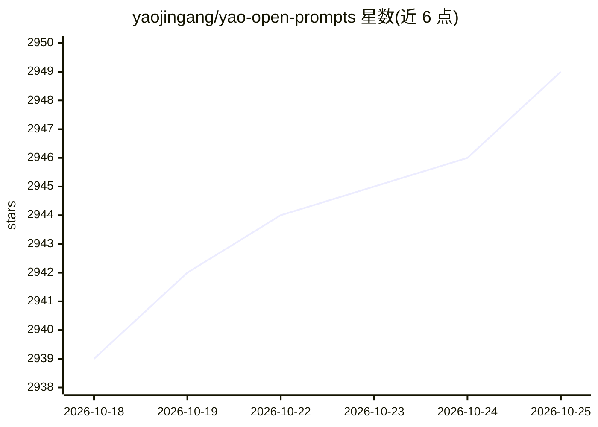

# yaojingang/yao-open-prompts

⭐ 2,949 · Python · NOASSERTION · 推送 2026-10-08 · [GitHub](https://github.com/yaojingang/yao-open-prompts) · [官网](https://yaojingang.github.io/yao-open-prompts/) · 个人维护 · 中文 README

**135 个中英双语 AI 提示词库：覆盖工作、学习、营销等场景**

《姚金刚提示词合集》的开源版本，从原始文档与书籍配套模板中整理出 135 个中文提示词文件，并同步提供英文镜像，按 AI 方法、工作、学习、内容、营销等 9 个场景分类组织。每个文件含统一 frontmatter 与可复制 Prompt 正文，使用方式为在 CATALOG.md 定位后复制并替换变量。重点条目包括基于 RTF 增强架构的元提示词设计系统 V1.0、宽幅知识插画信息图生成器和 GEO 文章优化模板。仓库附 Python 脚本用于目录生成、质量检查与网页重建，内容采用 CC BY 4.0 许可。

## 筛选速览

| 维度 | 判定 | 备注 |
|---|---|---|
| AI 角色 | `ai-knowledge` | 知识聚合/清单类 |
| 许可风险 | `none` | NOASSERTION |
| 部署形态 | `None` |  |
| 模型依赖 | — | README 未给出锁定关系 |
| 硬件要求 | — | 无带数字的原话,不猜 |
| 安装摩擦 | `low` | 无编译、无系统依赖或容器化 |
| 成熟度 | — | 结构信号不足 |

## 能力要点

- 135 个中文提示词文件，prompts-en/ 下按相同路径镜像英文版
- 9 个场景分类组织，含元提示词设计系统 V1.0 与 25 个 GEO 营销模板
- 统一 frontmatter 规范（title/category/subcategory/tags/version）
- 提供 6 个 Python 脚本支持目录重建、质量检查与网页生成

## 适用场景

- 按场景查找可直接复制的 AI 提示词用于写作、营销或学习
- 使用元提示词系统将自然语言需求编译为提示词
- 为已有文章做 GEO 优化以提升 AI 搜索可见度

## 场景标签

`提示工程` · 领域:Agent 开发

## 证据(README 行号)

> L5: 《姚金刚提示词合集》的开源版本，一个覆盖提示词工程、工作、学习、内容、营销和生活场景的中英双语 AI 提示词库。
> L7: 本仓库从原始合集文档、书籍配套模板和后续提示词目录中整理出 **135** 个中文提示词文件，并按场景重新分类。每个提示词保留可复制的正文，去除了原文中不适合放入开源仓库主体的教程推广、效果截图、视频附件说明和 HTML 样式残留。

## 星数曲线

2026-10-18 2,939 → 2026-10-25 2,949（+10）

---
*卡片 v1 · prompt 1.4 · 生成 2026-10-21 · 置信度 high · 依据 README sha `9b4a4d95921a` · [字段定义](../../DATASET.md)*
