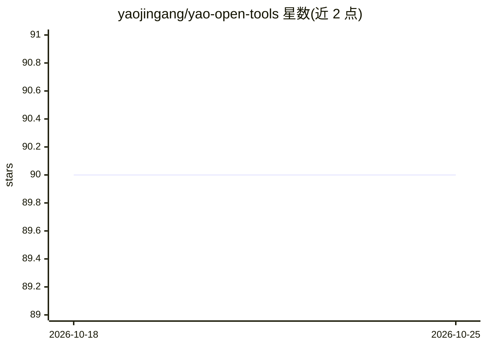

# yaojingang/yao-open-tools

⭐ 90 · PHP · MIT · 推送 2026-09-21 · [GitHub](https://github.com/yaojingang/yao-open-tools) · 个人维护 · 中文 README

**开发者小工具集合：本地优先的 AI 用量统计、截图、翻译、转写与诊断**

面向开发者的开源工具箱，含 11 个可独立安装的小工具：TokKit 统计 Codex、Claude Code、Cursor 等多种 AI 编码工具的 token 与成本（写入本地 SQLite，区分 exact/partial/estimated 精度）；tokscr/toktra 为 Chrome MV3 扩展，分别做网页截图与英译中辅助阅读；TokDoc/TokURL/TokChat 为可自托管 Web 应用；vidbrief 做视频转写与 AI 报告；mem 与 Scai 做本机内存和磁盘诊断。默认本地优先，不依赖远程服务，整体 MIT 许可。各工具安装方式互不相同（pip/npm/Docker/源码）。

## 筛选速览

| 维度 | 判定 | 备注 |
|---|---|---|
| AI 角色 | `ai-enhanced` | 去掉 AI 部分产品仍成立 |
| 许可风险 | `permissive` | MIT |
| 部署形态 | `self-host` | docker 或自建部署 |
| 模型依赖 | — | README 未给出锁定关系 |
| 硬件要求 | — | 无带数字的原话,不猜 |
| 安装摩擦 | `low` | 无编译、无系统依赖或容器化 |
| 成熟度 | — | 结构信号不足 |

## 能力要点

- TokKit 从本地日志统计多 AI 编码工具的 token、成本与客户端覆盖率
- tokscr 本地完成截图拼接裁剪，不上传服务器；toktra 支持本地缓存译文与 PDF 双栏阅读
- 多个 Web 工具提供 Docker Compose 自托管部署
- mem/Scai 提供本机内存与磁盘空间的诊断和清理建议

## 适用场景

- 统计多个 AI 编码工具的 token 和成本花在哪里
- 长网页截图留档或英文网页/PDF 辅助阅读
- 自托管短链接、文档管理和 AI 对话应用
- 视频转写整理或本机内存、磁盘问题排查

## 场景标签

`语音识别` `LLM 可观测性` · 领域:评测与运维

## 证据(README 行号)

> L28: |TokKit|Python CLI|`tok` / `tokkit`|AI 编码工具使用量台账，统计 token、成本、模型、终端、客户端和来源覆盖率。|
> L36: |vidbrief|Python CLI/TUI|`vb`|视频下载、字幕或音频转写、Transcript 整理和 AI 报告生成。|
> L223: 它适合在 Mac 或 Linux 机器出现卡顿、内存压力、进程异常占用时快速定位问题。工具会聚合软件级别的资源占用，并提供下一步引导，例如 AI 建议、优化指令和持续观察。

## 星数曲线

2026-10-18 90 → 2026-10-25 90（+0）

---
*卡片 v1 · prompt 1.4 · 生成 2026-10-23 · 置信度 mid · 依据 README sha `f4e5a3fa7974` · [字段定义](../../DATASET.md)*
