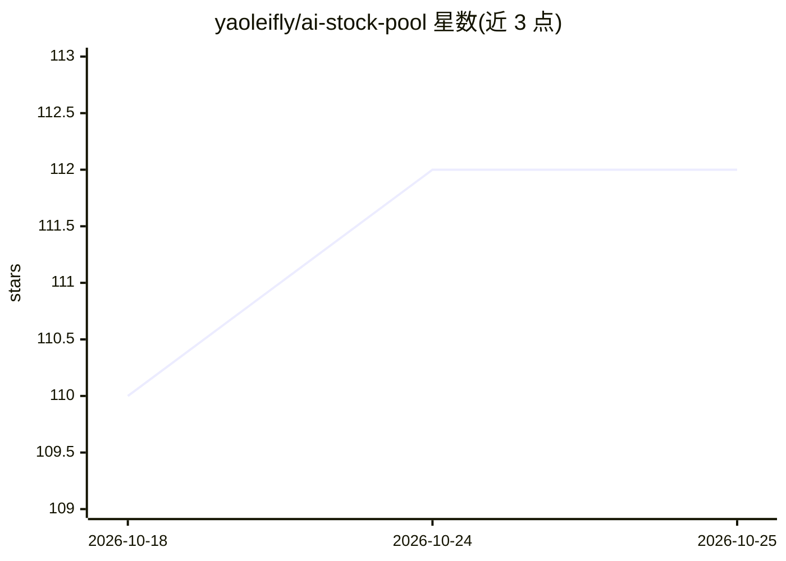

# yaoleifly/ai-stock-pool

⭐ 112 · Python · MIT · 推送 2026-10-25 · [GitHub](https://github.com/yaoleifly/ai-stock-pool) · [官网](https://stocks.mastersgo.cc) · 个人维护 · 中文 README

**AI 产业链美股/A股股票池研究工作台：图谱、发现与政策压力**

面向投资研究的美股/A股产业链信息组织工具：提供关系图谱、特征矩阵、股票列表、主动发现（官方信号/新闻/arXiv 论文联合评分）与政策压力指数（六项指标加权）。发现引擎只生成 observe/already_in_pool/reject 等研究建议，不自动改写正式股票池，需人工核实。前端无框架依赖、直读静态 CSV/JSON 与同域 API，支持 Vercel 与 Cloudflare Workers 一键部署（无需 API Key，可选配置 DeepSeek 用于移动端分析接口）。README 明确声明非自动交易系统、不构成投资建议。

## 筛选速览

| 维度 | 判定 | 备注 |
|---|---|---|
| AI 角色 | `ai-enhanced` | 去掉 AI 部分产品仍成立 |
| 许可风险 | `permissive` | MIT |
| 部署形态 | `library` | 以包/库形式分发 |
| 模型依赖 | — | README 未给出锁定关系 |
| 硬件要求 | — | 无带数字的原话,不猜 |
| 安装摩擦 | `low` | 无编译、无系统依赖或容器化 |
| 成熟度 | — | 结构信号不足 |

## 能力要点

- 官方信号/新闻/arXiv/行情位置联合评分的主动发现引擎
- 六项指标加权的政策压力指数与机构拥挤度反向风险提示
- Vercel 与 Cloudflare Workers 双部署路径，均无需 API Key
- 数据文件与评分来源透明，正式入池须人工核实

## 适用场景

- 梳理 AI 产业链上中下游布局与美股/A股映射关系
- 跟踪 arXiv 论文与新闻信号形成的研究候选队列
- 查看政策压力、机构预期修正与财报反应时间线

## 场景标签

`金融量化` `知识图谱` · 领域:知识与检索

## 证据(README 行号)

> L3: 面向投资研究的美股 / A 股产业链工作台：关系图谱、主动发现、arXiv 信号、行情位置与政策压力。
> L36: |主动发现|官方信号、新闻、arXiv、股票池与行情位置联合评分|4 份 discovery CSV + 日报|
> L43: - arXiv 上与 AI 推理、存储、网络、机器人、先进封装等相关的论文；
> L105: - `/api/mobile/analyze` 需要通过 `npx wrangler secret put DEEPSEEK_API_KEY` 配置密钥；未配置时返回明确的 503 状态。可选 `DEEPSEEK_MODEL`，

## 星数曲线

2026-10-18 110 → 2026-10-25 112（+2）

---
*卡片 v1 · prompt 1.4 · 生成 2026-10-23 · 置信度 mid · 依据 README sha `f17b42800c5a` · [字段定义](../../DATASET.md)*
