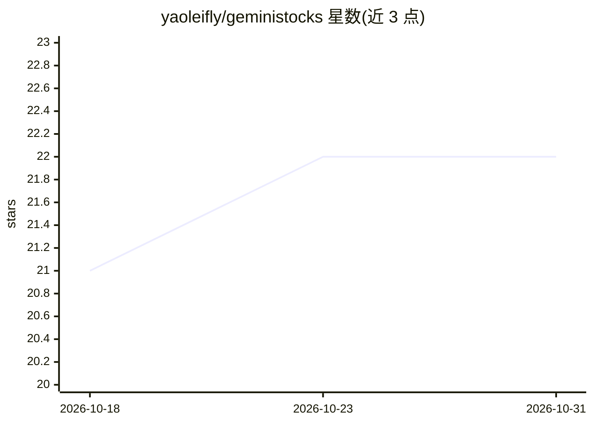

# yaoleifly/geministocks

⭐ 22 · TypeScript · MIT · 推送 2026-10-15 · [GitHub](https://github.com/yaoleifly/geministocks) · [官网](https://mastersgo.cc) · 个人维护 · 中文 README

**自带模型（BYOM）的 AI 投研工具：把财经新闻生成结构化分析报告**

基于 React + Vite + TypeScript 的客户端优先 Web 应用：用户输入主题、新闻或链接，由用户自带的 AI 模型（云端 API 或本机 CLI）执行三段并行分析，产出含投资吸引力评分与信息差评分的报告；可接入 Exa/AnySearch 实时检索并展示全部引用来源，聚合雪球、虎嗅、彭博等多个新闻源并提取 AI 概念标签，分析历史本地保存可复盘。API Key 仅存于浏览器 localStorage，服务端仅做 CORS 转发、不存储密钥。需 Node.js 18+，pnpm 本地运行，支持 Vercel 与 Cloudflare Workers 部署。

## 筛选速览

| 维度 | 判定 | 备注 |
|---|---|---|
| AI 角色 | `ai-native` | 本体是模型或模型工具 |
| 许可风险 | `permissive` | MIT |
| 部署形态 | `library` | 以包/库形式分发 |
| 模型依赖 | local-ok | 支持本地模型 |
| 硬件要求 | — | 无带数字的原话,不猜 |
| 安装摩擦 | `low` | 无编译、无系统依赖或容器化 |
| 成熟度 | — | 结构信号不足 |

## 能力要点

- BYOM：支持 OpenRouter、DeepSeek、MiniMax、Ollama 及任意 OpenAI 兼容端点，自动检测本机 CLI
- 三段并行分析生成投资吸引力评分与信息差评分
- API Key 仅存浏览器 localStorage，客户端直连模型服务商
- 可选 Exa/AnySearch 实时搜索，报告中展示全部引用来源

## 适用场景

- 把一条财经新闻或主题快速变成多维结构化投研报告
- 追踪概念标签对应的最新动态并一键发起分析
- 用本地或自有 API 的模型做投资研究，密钥不离开浏览器

## 场景标签

`金融量化` · 领域:学习与行业

## 证据(README 行号)

> L5: AI-powered investment research tool. Turn any financial news or topic into a structured, multi-dimensional analysis 
> L18: - **Bring Your Own Model (BYOM)**
> L78: - **挖掘分析**：输入主题/新闻/链接，三段并行分析生成完整报告，含**投资吸引力评分**与**信息差评分**（衡量市场是否已消化该信息）

## 星数曲线

2026-10-18 21 → 2026-10-31 22（+1）

---
*卡片 v1 · prompt 1.4 · 生成 2026-10-27 · 置信度 mid · 依据 README sha `2a087e35b822` · [字段定义](../../DATASET.md)*
