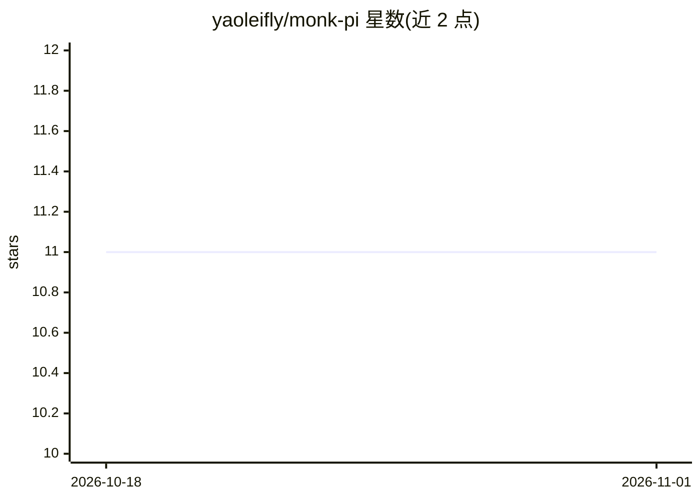

# yaoleifly/monk-pi

⭐ 11 · TypeScript · 推送 2026-10-14 · [GitHub](https://github.com/yaoleifly/monk-pi) · 个人维护 · 中文 README

**零配置接入 Monk API 运行 Pi 终端编码代理的工具**

面向使用 monk.party 付费 API 的开发者，将 Pi 终端 Coding Agent 与 Monk 的 OpenAI Chat Completions 融合模型（1M 上下文，monk/monk-fast/monk-coding/monk-free）打通：首次启动自动校验 Key 并注入 Pi 配置，协议锁定 OpenAI Chat Completions。提供 CLI 指令（模型切换、诊断、会话恢复）、TUI slash 命令、命令报错自动捕获并触发 AI 修复、@diff 等上下文宏、文件快照与 /undo 回退、中文工程提示词。限制：需付费 Key（¥30 或 $5 / 30 天），不支持 Anthropic 预设。

## 筛选速览

| 维度 | 判定 | 备注 |
|---|---|---|
| AI 角色 | `ai-ecosystem` | LLM/agent 周边工具 |
| 许可风险 | `none` | — |
| 部署形态 | `library` | 以包/库形式分发 |
| 模型依赖 | — | README 未给出锁定关系 |
| 硬件要求 | — | 无带数字的原话,不猜 |
| 安装摩擦 | `low` | 无编译、无系统依赖或容器化 |
| 成熟度 | — | 结构信号不足 |

## 能力要点

- 首次启动自动完成密钥校验与 Pi 运行时配置注入
- monk-pi run 监控本地命令，报错时自动捕获日志并触发 AI 修复
- @diff/@staged/@recent/@git 上下文宏自动提取 Git 状态
- 轮次级文件快照与 /undo 一键回退（无需 Git 仓库）

## 适用场景

- 在终端用 Monk API 直接进行交互式编码与代码审查
- 本地构建/测试命令失败时一键让 AI 分析并修复
- 自动生成符合 Conventional Commits 的中文提交信息

## 场景标签

`编码 Agent` `代码审查` · 领域:编码与开发

## 证据(README 行号)

> L4: > 将 Monk 的 OpenAI Chat Completions 融合模型（支付宝 ¥30 / 30 天，或 Stripe $5 / 30 天，教育邮箱 9 折 · 1M 上下文 · Agent 原生适配）与 Pi 的极速灵活终
> L9: - **零配置接入**：彻底告别繁琐的手写 `models.json` 和 `compat` 参数配置。首次启动自动完成密钥检验与环境注入。协议锁定 OpenAI Chat Completions，不会走 Anthropic 预设。
> L168: Monk-Pi 自动为 Pi 部署原生扩展 (`~/.pi/agent/extensions/monk.ts`)：

## 星数曲线

2026-10-18 11 → 2026-11-01 11（+0）

---
*卡片 v1 · prompt 1.4 · 生成 2026-11-01 · 置信度 high · 依据 README sha `8d6ffb63e693` · [字段定义](../../DATASET.md)*
