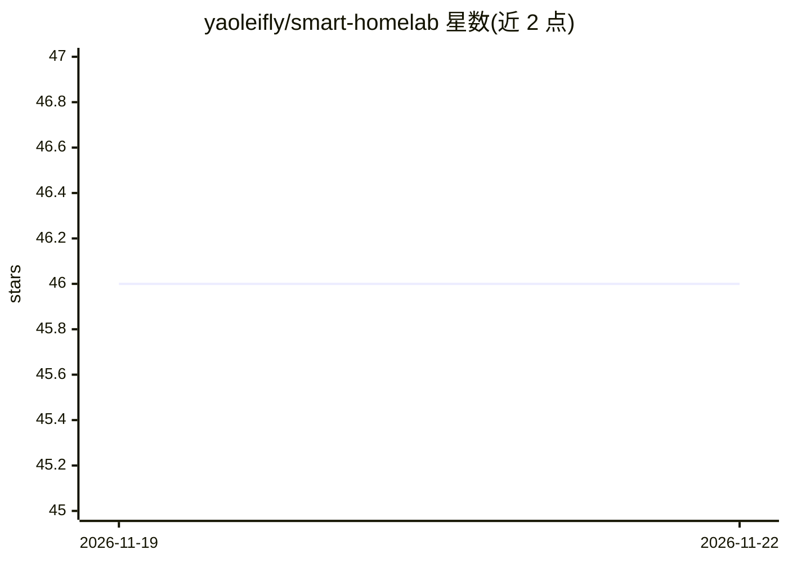

# yaoleifly/smart-homelab

⭐ 46 · HTML · 推送 2026-03-20 · [GitHub](https://github.com/yaoleifly/smart-homelab) · 个人维护 · 中文 README

**为 OpenWrt 路由器提供自托管 AI 辅助监控仪表盘**

通过 SSH 每 5 分钟采集 OpenWrt 路由器的 WAN 状态、延迟、丢包、内存、CPU、流量与 WiFi 客户端等指标，存入本地 SQLite，并在单页仪表盘呈现；支持健康评分、7×24 流量热力图、MAC OUI 设备分类、SSH 暴力破解审计与 iptables 封禁、阈值自动修复（默认 observe 模式仅记录）及 Telegram 告警。可选配置 Claude API Key 后支持自然语言问答与异常摘要。依赖 Node.js ≥18 与 sshpass，提供一键脚本、git clone 与 pm2 部署方式，无云依赖与遥测。

## 筛选速览

| 维度 | 判定 | 备注 |
|---|---|---|
| AI 角色 | `ai-enhanced` | 去掉 AI 部分产品仍成立 |
| 许可风险 | `permissive` | — |
| 部署形态 | `library` | 以包/库形式分发 |
| 模型依赖 | locked-api |  |
| 硬件要求 | — | 无带数字的原话,不猜 |
| 安装摩擦 | `low` | 无编译、无系统依赖或容器化 |
| 成熟度 | — | 结构信号不足 |

## 能力要点

- SSH 采集路由器指标存入本地 SQLite，零云依赖、零遥测
- 可选 Claude API 集成，基于实时路由器数据回答自然语言问题
- 阈值自动修复支持重启 WAN/DNS/WiFi/防火墙，默认 observe 模式
- WiFi 客户端双源采集并按 250+ OUI 前缀自动分类设备类型

## 适用场景

- 在家自托管监控 OpenWrt 路由器的健康与流量
- 用自然语言询问网络变慢等异常的原因
- 自动检测并重启出问题的 WAN、DNS 或 WiFi 服务
- 通过 Telegram 接收断网、高负载与暴力破解告警

## 场景标签

`AI 助手` · 领域:对话与助手

## 证据(README 行号)

> L16: Smart Homelab turns your OpenWrt router into a fully observable, AI-assisted network operations center — running en
> L20: The optional Claude AI integration lets you ask plain-language questions like *"Why is my network slow tonight?"* a
> L36: ### 🤖 AI Assistant

## 星数曲线

2026-11-19 46 → 2026-11-22 46（+0）

---
*卡片 v1 · prompt 1.4 · 生成 2026-11-19 · 置信度 high · 依据 README sha `36643f73b2e3` · [字段定义](../../DATASET.md)*
