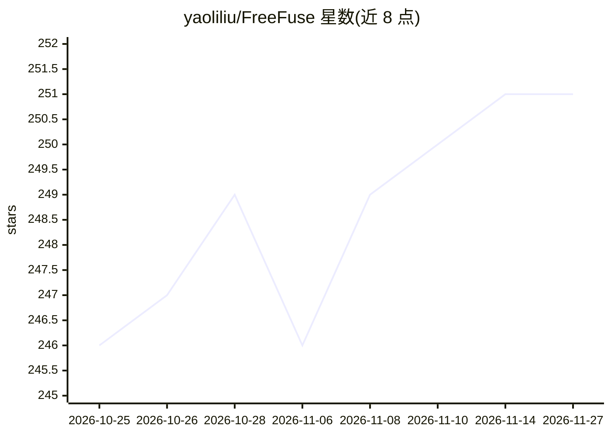

# yaoliliu/FreeFuse

⭐ 251 · Python · Apache-2.0 · 推送 2026-11-06 · [GitHub](https://github.com/yaoliliu/FreeFuse) · [官网](https://future-item.github.io/FreeFuse/) · 组织维护

**多主体 LoRA 免训练融合推理库：多角色一图生成**

TMLR 论文 FreeFuse 的官方实现，通过推理阶段的自适应 Token 级路由（FreeFuseAttn）将多个主体 LoRA 融合到同一张图，无需重训练 LoRA、无需模型修改或用户绘制遮罩，只需提供主体激活词即可接入标准工作流。支持 Flux.dev、SDXL、Z-Image-turbo、FLUX.2-klein、Krea2 等模型的 diffusers 与 ComfyUI 两条运行路径，并可叠加 ControlNet/IPAdapter/Redux；显存不足时可开启量化降低占用。

## 筛选速览

| 维度 | 判定 | 备注 |
|---|---|---|
| AI 角色 | `ai-native` | 本体是模型或模型工具 |
| 许可风险 | `permissive` | Apache-2.0 |
| 部署形态 | `library` | 以包/库形式分发 |
| 模型依赖 | — | README 未给出锁定关系 |
| 硬件要求 | — | 无带数字的原话,不猜 |
| 安装摩擦 | `low` | 无编译、无系统依赖或容器化 |
| 成熟度 | — | 结构信号不足 |

## 能力要点

- 训练时无需额外训练或用户定义 mask，仅需主体激活词
- FreeFuseAttn 在去噪早期动态匹配主体 token 与空间区域
- 支持 diffusers 与 ComfyUI 双路径及 ControlNet/IPAdapter/Redux 叠加
- 支持量化选项以降低 VRAM 占用

## 适用场景

- 用多个角色 LoRA 生成单张多主体图像
- 在 ComfyUI 工作流中免训练融合多个主体 LoRA
- 显存有限时开量化运行 Flux 多主体生成

## 场景标签

`图像生成` · 领域:内容生成

## 证据(README 行号)

> L26: This paper proposes **FreeFuse**, a training-free framework for multi-subject text-to-image generation through auto
> L48: ## 🚀 Quick Start

## 星数曲线

2026-10-25 246 → 2026-11-27 251（+5）

---
*卡片 v1 · prompt 1.4 · 生成 2026-11-25 · 置信度 high · 依据 README sha `f70cf102ba79` · [字段定义](../../DATASET.md)*
