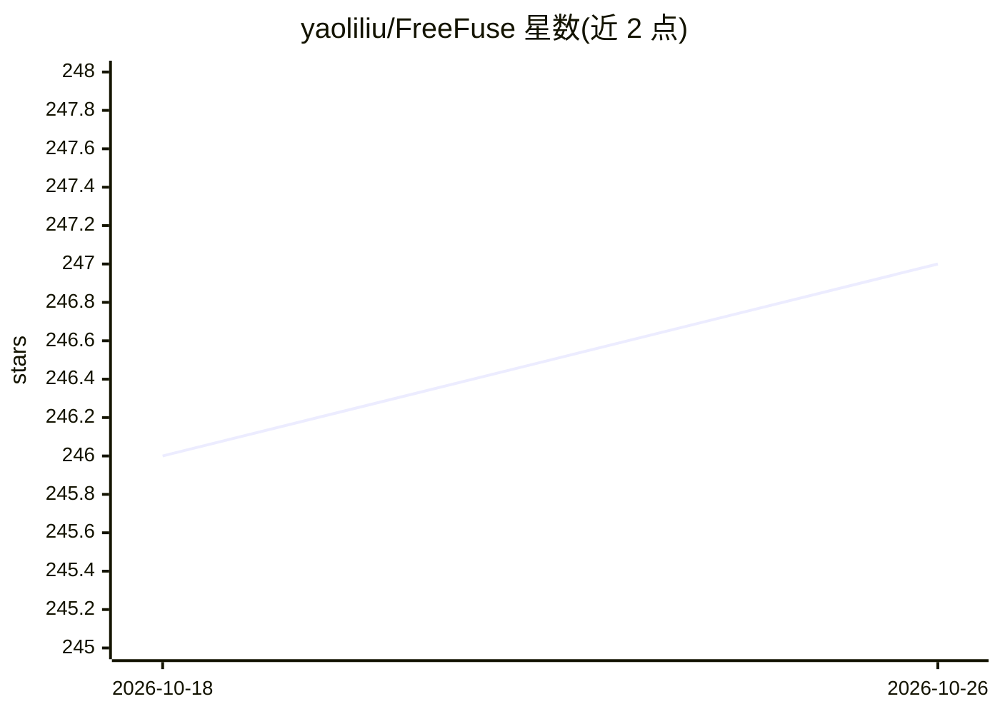

# yaoliliu/FreeFuse

⭐ 247 · Python · Apache-2.0 · 推送 2026-10-25 · [GitHub](https://github.com/yaoliliu/FreeFuse) · [官网](https://future-item.github.io/FreeFuse/) · 组织维护

**免训练多主体 LoRA 融合文生图框架：测试时自适应 token 级路由**

论文研究代码（TMLR26 投稿）：在流匹配文生图模型的推理阶段融合多个主体 LoRA，实现多主体组合生成。核心机制 FreeFuseAttn 利用流匹配模型自身的语义对齐，在去噪早期时间步将主体特定 token 动态匹配到对应空间区域，无需额外训练、模型修改、外部分割器或用户定义遮罩，用户只需提供主体激活词。支持 Flux.dev、SDXL、Z-Image-turbo、FLUX.2-klein、Krea2 等模型，可经 ComfyUI 节点或 diffusers 源码运行，配合 ControlNet/IPAdapter/Redux 使用，支持量化以降低显存占用。

## 筛选速览

| 维度 | 判定 | 备注 |
|---|---|---|
| AI 角色 | `ai-native` | 本体是模型或模型工具 |
| 许可风险 | `permissive` | Apache-2.0 |
| 部署形态 | `library` | 以包/库形式分发 |
| 模型依赖 | — | README 未给出锁定关系 |
| 硬件要求 | — | 无带数字的原话,不猜 |
| 安装摩擦 | `low` | 无编译、无系统依赖或容器化 |
| 成熟度 | — | 结构信号不足 |

## 能力要点

- 免训练推理阶段多主体 LoRA 融合，无需遮罩或外部分割器
- FreeFuseAttn 自适应 token 级路由机制
- 支持 ComfyUI 与 diffusers 双工作流
- 兼容 ControlNet、IPAdapter、Redux 及多种底模（Flux/SDXL/Z-Image/FLUX.2-klein/Krea2）

## 适用场景

- 文生图时将多个主体 LoRA 融合到同一画面
- 在 ComfyUI 工作流中做多主体组合生成
- 搭配 ControlNet/IPAdapter 控制构图与参考图像

## 场景标签

`图像生成` · 领域:内容生成

## 证据(README 行号)

> L24: This paper proposes **FreeFuse**, a training-free framework for multi-subject text-to-image generation through auto
> L44:  Overview of FreeFuse architecture. FreeFuseAttn dynamically routes subject-specific LoRAs to their corresponding s

## 星数曲线

2026-10-18 246 → 2026-10-26 247（+1）

---
*卡片 v1 · prompt 1.4 · 生成 2026-10-22 · 置信度 mid · 依据 README sha `28f36d386549` · [字段定义](../../DATASET.md)*
