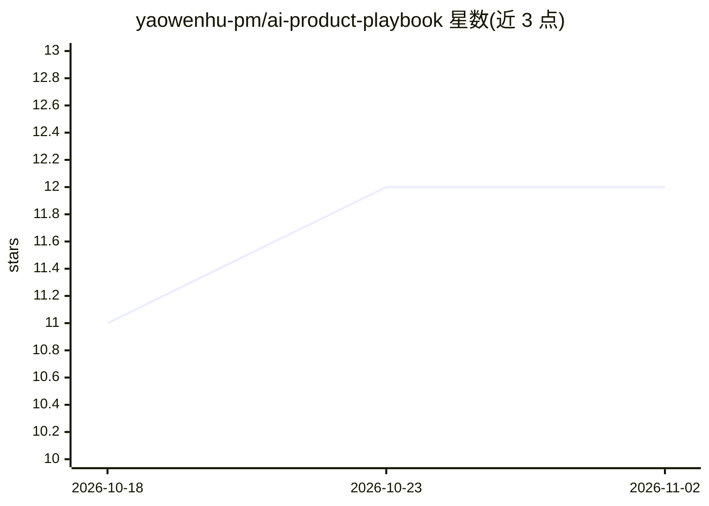

# yaowenhu-pm/ai-product-playbook

⭐ 12 · JavaScript · MIT · 推送 2026-11-01 · [GitHub](https://github.com/yaowenhu-pm/ai-product-playbook) · [官网](https://yaowenhu-pm.github.io/ai-product-playbook/) · 个人维护 · 中文 README

**面向 AI 产品经理的在线实践手册：模型、Agent、产品三层方法**

持续更新的公开在线书，按模型能力与边界、Agent 系统与平台、产品与应用三个层次共 14 章组织内容，另含 5 篇工具箱（Prompt 模板、工作流、盲测协议）与 2 篇案例库。面向 AI 产品经理，沉淀产品判断、Prompt、Skill、Agent 与 AI 工作流实践经验。更新原则规定先记录实践再抽象方法、内容可被后续证据推翻或删除。以 MIT 许可发布。

## 筛选速览

| 维度 | 判定 | 备注 |
|---|---|---|
| AI 角色 | `ai-knowledge` | 知识聚合/清单类 |
| 许可风险 | `permissive` | MIT |
| 部署形态 | `None` |  |
| 模型依赖 | — | README 未给出锁定关系 |
| 硬件要求 | — | 无带数字的原话,不猜 |
| 安装摩擦 | `low` | 无编译、无系统依赖或容器化 |
| 成熟度 | — | 结构信号不足 |

## 能力要点

- 模型/平台/应用三层次共 14 章结构化目录
- 工具箱含记忆筛选器 Prompt、文件驱动工作流、VLM 盲测协议等 5 篇
- 明确的更新原则：内容可被推翻、合并、降级或删除

## 适用场景

- AI 产品经理系统性学习模型能力边界与 Agent 系统设计
- 查找可直接复用的 Prompt 模板与工作流
- 参考真实事故案例的沉淀方式

## 场景标签

`教程课程` · 领域:学习与行业

## 证据(README 行号)

> L3: AI 产品经理的实践手册。
> L7: 这是一本持续更新的公开在线书，从模型能力与边界、Agent 系统与平台、产品与应用三个层次，整理 AI 产品实践中的真实问题、判断和方法。

## 星数曲线

2026-10-18 11 → 2026-11-02 12（+1）

---
*卡片 v1 · prompt 1.4 · 生成 2026-10-31 · 置信度 high · 依据 README sha `8b3f42341711` · [字段定义](../../DATASET.md)*
