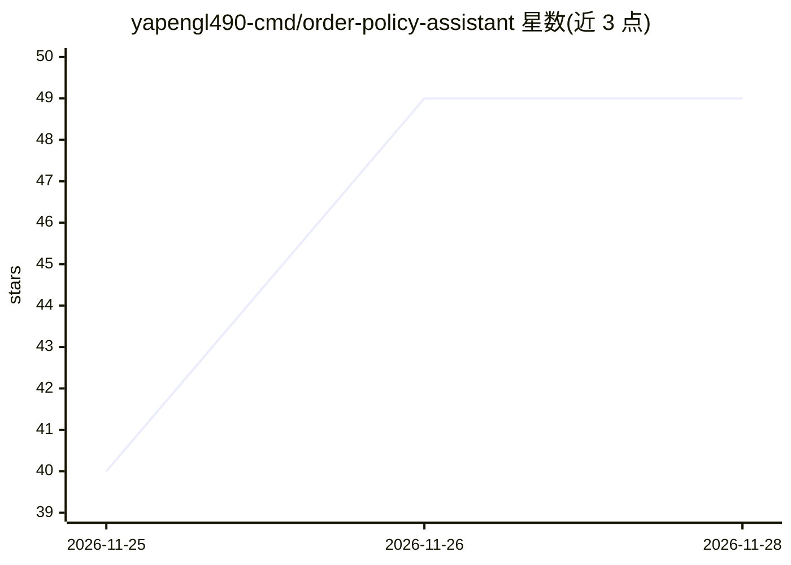

# yapengl490-cmd/order-policy-assistant

⭐ 49 · Python · MIT · 推送 2026-11-25 · [GitHub](https://github.com/yapengl490-cmd/order-policy-assistant) · 个人维护 · 中文 README

**给买家与商家做只读订单与售后政策核查的演示应用**

本仓库是一个可运行的个人工程演示：买家只读查询本人订单与适用政策，商家核对预授权店铺的金额变化，输出带条款依据的结论并保留引用行号。系统把模型职责与程序职责分开——模型决定调用哪些已授权工具并组织语言，身份、数据范围、金额计算与规则校验由程序执行。默认以合成数据运行、不联网读取平台、不调用付费模型；模型聊天与 Shopify、飞书入口为可选配置。技术上采用 Python/FastAPI/PostgreSQL 与 MCP 工具协议，提供 Docker Compose 部署与 `demo.py` 免费验收入口。

## 筛选速览

| 维度 | 判定 | 备注 |
|---|---|---|
| AI 角色 | `ai-native` | 本体是模型或模型工具 |
| 许可风险 | `permissive` | MIT |
| 部署形态 | `library` | 以包/库形式分发 |
| 模型依赖 | — | README 未给出锁定关系 |
| 硬件要求 | — | 无带数字的原话,不猜 |
| 安装摩擦 | `low` | 无编译、无系统依赖或容器化 |
| 成熟度 | — | 结构信号不足 |

## 能力要点

- 只读边界：程序侧实现身份、授权范围、金额整数分计算与规则校验
- 政策匹配按支付时刻选版本，条款可按文件与行号回查
- MCP 工具协议独立网络服务，模型无数据库管理员权限
- 默认无模型免费演示，`demo.py check` 含 15 项离线核查

## 适用场景

- 演示买家查询订单退款截止与退货资格
- 演示商家核对授权店铺两期金额变化及原因证据
- 作为订单/政策问答系统的工程结构参考

## 场景标签

`RAG` `文档问答` · 领域:知识与检索

## 证据(README 行号)

> L3: 面向**买家查询本人订单与适用政策、商家核对授权店铺金额变化**的只读应用。它把数据库事实、政策条件判断与模型解释分开：模型决定调用哪些已允许的工具并组织语言，程序负责身份、数据范围、金额计算、规则校验和执行限额。
> L131: - 模型工具循环使用显式状态与共享限额；未安装 LangGraph（状态图框架）。检索文本不授予执行权限，模型输出需再次校验。

## 星数曲线

2026-11-25 40 → 2026-11-28 49（+9）

---
*卡片 v1 · prompt 1.4 · 生成 2026-11-24 · 置信度 low · 依据 README sha `1ba42ff401b0` · [字段定义](../../DATASET.md)*
