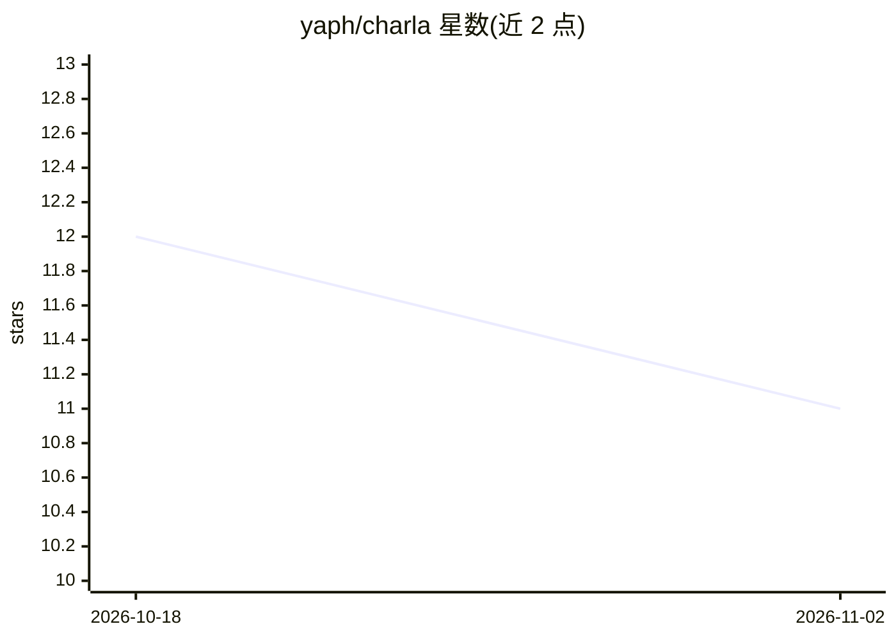

# yaph/charla

⭐ 11 · Python · MIT · 推送 2026-10-01 · [GitHub](https://github.com/yaph/charla) · [官网](https://geeksta.net/geeklog/charla-introduction/) · 个人维护

**终端里与语言模型对话的聊天客户端**

基于终端的聊天应用，通过集成 Ollama 与本地或云端语言模型交互，支持上下文对话、系统提示、单/多行输入切换、消息与提示历史自动保存及会话续聊。可将本地文件和网页内容附加到提示，并在终端渲染 Markdown。配置可经命令行参数、用户配置文件或当前目录 .charla.json 管理。经 pipx 安装，需本地已运行 Ollama 服务并安装模型方可使用本地模型。

## 筛选速览

| 维度 | 判定 | 备注 |
|---|---|---|
| AI 角色 | `ai-ecosystem` | LLM/agent 周边工具 |
| 许可风险 | `permissive` | MIT |
| 部署形态 | `library` | 以包/库形式分发 |
| 模型依赖 | local-ok | 支持本地模型 |
| 硬件要求 | — | 无带数字的原话,不猜 |
| 安装摩擦 | `low` | 无编译、无系统依赖或容器化 |
| 成熟度 | — | 结构信号不足 |

## 能力要点

- 集成 Ollama，支持本地与云端模型
- 会话自动保存、可续聊，提示历史自动建议
- 可将本地文件与网页内容附加到提示
- 终端内渲染 Markdown 回复

## 适用场景

- 在终端中与本地或云端语言模型持续对话
- 把文件或网页内容带入提示进行问答
- 保存并随时继续历史会话

## 场景标签

`聊天机器人` · 领域:对话与助手

## 证据(README 行号)

> L6: **Charla** is a terminal based application for chatting with language models. Charla integrates with Ollama for exch
> L13: * Support for local and cloud models via Ollama.

## 星数曲线

2026-10-18 12 → 2026-11-02 11（-1）

---
*卡片 v1 · prompt 1.4 · 生成 2026-10-31 · 置信度 high · 依据 README sha `e03a321f6085` · [字段定义](../../DATASET.md)*
