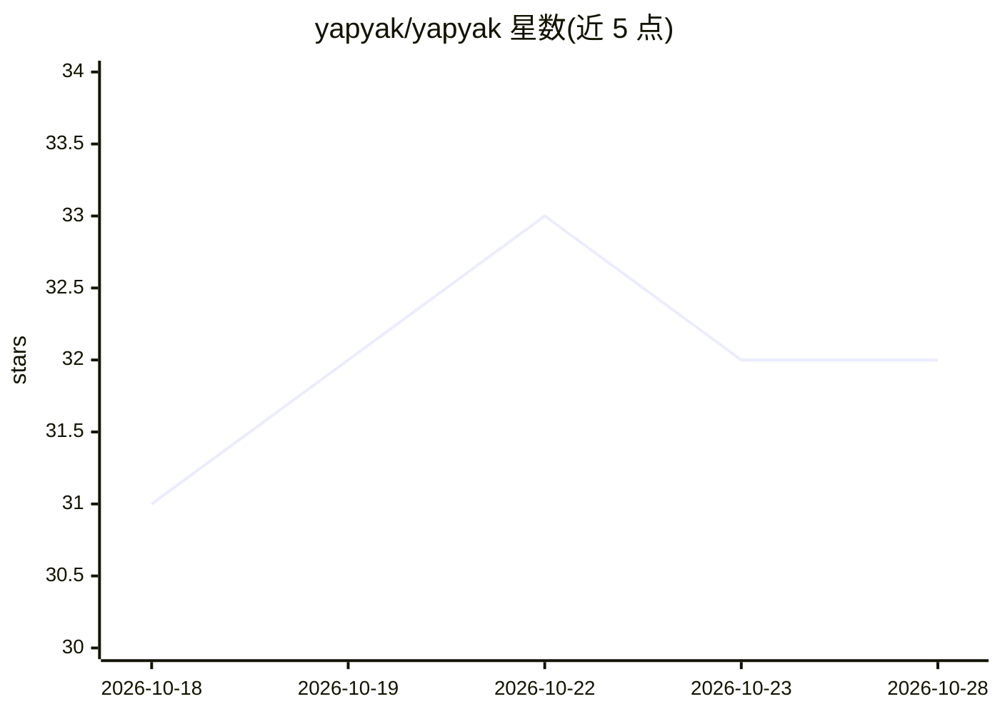

# yapyak/yapyak

⭐ 32 · TypeScript · MIT · 推送 2026-10-15 · [GitHub](https://github.com/yapyak/yapyak) · [官网](https://yapyak.dev) · 个人维护

**面向开发工作流的 i18n 编译器，保存即由 AI 补全翻译**

yapyak 是一个 Vite 插件形式的 i18n 编译器加小型运行时，支持 React、Vue、Svelte、Astro，SSR 支持 Nuxt、React Router、SvelteKit、TanStack Start 等。源字符串即键，保存文件时自动加入 locale 文件，可连接模型在后台补全翻译；运行时零依赖，典型约 5 KB gzip，固定 locale 构建零运行时。内置 Anthropic、OpenAI、Gemini、Ollama、Claude Code 等翻译后端，也可不用 AI 手填 JSON。附带 VS Code 扩展与 coding agent 技能。pre-1.0，版本 0.0.x，可能含破坏性变更。

## 筛选速览

| 维度 | 判定 | 备注 |
|---|---|---|
| AI 角色 | `ai-enhanced` | 去掉 AI 部分产品仍成立 |
| 许可风险 | `permissive` | MIT |
| 部署形态 | `library` | 以包/库形式分发 |
| 模型依赖 | local-ok | 支持本地模型 |
| 硬件要求 | — | 无带数字的原话,不猜 |
| 安装摩擦 | `low` | 无编译、无系统依赖或容器化 |
| 成熟度 | `idea` | |

## 能力要点

- 源字符串即键，保存时自动进入 locale 文件并由 AI 后台翻译
- 运行时零依赖（基于 Intl API），固定 locale 构建零运行时
- 内置 Anthropic/OpenAI/Gemini/Ollama/Claude Code 后端，也可不用 AI
- 编号诊断（YAP0001 起）与 TypeScript 类型错误提示

## 适用场景

- 在 Vite 项目中做 i18n 而无需单独的翻译流程
- 让 coding agent 接管国际化字符串的写入与修复
- 翻译文件以 JSON 形式随代码入库并用自有 API key 调用模型

## 场景标签

`AI 写作` · 领域:内容生成

## 证据(README 行号)

> L10: yapyak is an i18n compiler with a small runtime, built for the way code gets written today: rapidly, often with hel
> L49: - **Bring your own AI. Or none.** Anthropic, OpenAI, Gemini, Ollama, and Claude Code are built in. Write your own, 
> L60: yapyak is pre-1.0: every release is `0.0.x`, and any of them may contain breaking changes. Each one is listed in BR

## 星数曲线

2026-10-18 31 → 2026-10-28 32（+1）

---
*卡片 v1 · prompt 1.4 · 生成 2026-10-25 · 置信度 mid · 依据 README sha `522f134970f8` · [字段定义](../../DATASET.md)*
